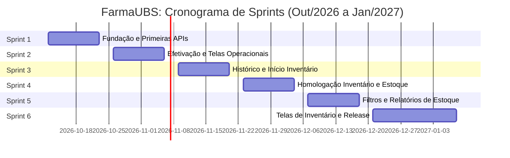

# Planejamento de sprints e roadmap de desenvolvimento: FarmaUBS

## 1. Visão geral e capacidade

Este documento define o cronograma de sprints para implementar os épicos do FarmaUBS: Dispensação (Épico 2), Recebimento (Épico 3), Controle de Estoque (Épico 4) e Inventário Mensal (Épico 5). Ele toma como base os requisitos canônicos ([farmaubs-requisitos.md](./documento-requisitos/farmaubs-requisitos.md)), as decisões da entrevista de 29/09/2026 e os registros de arquitetura (ADRs).

| Parâmetro | Definição |
| --- | --- |
| Início | 12 de outubro de 2026 |
| Duração da sprint | 2 semanas (10 dias úteis) |
| Equipe backend | 3 desenvolvedores (Dev BE 1, Dev BE 2, Dev BE 3) |
| Equipe frontend | 1 desenvolvedor (Dev FE) |
| Organização backend | Cada desenvolvedor backend assume um épico em paralelo |
| Organização frontend | O desenvolvedor frontend entrega as telas consumindo as APIs prontas |
| Ritmo estimado | 2 a 3 histórias por desenvolvedor a cada sprint |
| Volume total | 36 histórias (18 backend e 18 frontend) em 6 sprints |

---

## 2. Cronograma das sprints

| Sprint | Período | Foco principal |
| --- | --- | --- |
| Sprint 1 | 12/10/2026 a 23/10/2026 | Schemas, migrações, catálogo e consultas básicas (DI, RE, ES), além dos formulários iniciais de tela |
| Sprint 2 | 26/10/2026 a 06/11/2026 | Transações de dispensação, entrada e ajuste, junto com conferência de recebimento e seleção FEFO |
| Sprint 3 | 09/11/2026 a 20/11/2026 | Histórico com filtro ontem/hoje, backend de inventário e telas centrais de dispensação e recebimento |
| Sprint 4 | 23/11/2026 a 04/12/2026 | Fechamento do backend de inventário, painel de histórico de dispensas e tabela de saldos com alerta laranja |
| Sprint 5 | 07/12/2026 a 18/12/2026 | Filtros de estoque no mês corrente, modais de ajuste/rastreabilidade e exportação em XLSX |
| Sprint 6 | 21/12/2026 a 08/01/2027 | Telas de contagem, mapa com justificativa Outros, Ata Oficial impressa e testes finais |

---

## 3. Detalhamento sprint a sprint

### Sprint 1: Fundação de schemas, catálogo e primeiras APIs
**Período:** 12 de outubro de 2026 a 23 de outubro de 2026  
**Meta:** Rodar as migrações básicas de dispensação e recebimento, liberar endpoints de catálogo/pacientes e montar os formulários iniciais.

#### Backend
- Dev BE 1: Épico 2 (Dispensação)
  - [`DI-01`](./historias-usuario/2-epico-dispensacao-de-medicamentos/di-01-backend-migrations-schema-dispensacao.md): Migrações do schema de dispensação (`pacientes`, `dispensacoes`, `dispensacao_itens` e movimentações).
  - [`DI-02`](./historias-usuario/2-epico-dispensacao-de-medicamentos/di-02-backend-api-pacientes-cadastro-historico.md): API de Pacientes com validação obrigatória (CNS, CPF, nome e nascimento) e histórico de consumo.
  - [`DI-03`](./historias-usuario/2-epico-dispensacao-de-medicamentos/di-03-backend-api-dispensacao-busca-produtos-lotes-fefo.md): API de Dispensação com busca textual e ordenação FEFO.
- Dev BE 2: Épico 3 (Recebimento)
  - [`RE-01`](./historias-usuario/3-epico-recebimento-de-medicamentos/re-01-backend-migrations-schema-recebimento.md): Migrações do schema de recebimento (`documentos_entrada`, `recebimento_itens`, `lotes`, `fabricantes` e movimentações).
  - [`RE-02`](./historias-usuario/3-epico-recebimento-de-medicamentos/re-02-backend-api-catalogo-busca-produtos-fabricantes.md): API de Catálogo com busca textual de produtos e gestão de fabricantes.
- Dev BE 3: Épico 4 (Controle de Estoque)
  - [`ES-01`](./historias-usuario/4-epico-controle-de-estoque/es-01-backend-api-analitica-metricas-criticidade-estoque.md): API Analítica com métricas de criticidade, totalizadores, cálculo de ruptura e validade curta.
  - [`ES-02`](./historias-usuario/4-epico-controle-de-estoque/es-02-backend-api-saldos-consulta-paginada-filtros.md): API de Saldos com paginação, categorias, lotes e filtros de status.

#### Frontend
- Dev FE: Formulários de entrada e identificação
  - [`RE-05`](./historias-usuario/3-epico-recebimento-de-medicamentos/re-05-frontend-formulario-recebimento-cabecalho-guia.md): Cabeçalho do recebimento com número do documento/guia CAF, seleção de origem e validações.
  - [`DI-06`](./historias-usuario/2-epico-dispensacao-de-medicamentos/di-06-frontend-identificacao-paciente-formulario-historico.md): Formulário de identificação do paciente (CNS, CPF, nome e nascimento) e histórico.

---

### Sprint 2: Transações atômicas de efetivação e telas de conferência
**Período:** 26 de outubro de 2026 a 06 de novembro de 2026  
**Meta:** Concluir as regras de entrada e saída de estoque com consistência ACID no backend e conectar conferência física e seleção FEFO no frontend.

#### Backend
- Dev BE 1: Épico 2 (Dispensação)
  - [`DI-04`](./historias-usuario/2-epico-dispensacao-de-medicamentos/di-04-backend-api-efetivacao-transacao-baixa-estoque.md): API de Efetivação com baixa transacional de estoque e validação de antimicrobianos.
  - [`DI-05`](./historias-usuario/2-epico-dispensacao-de-medicamentos/di-05-backend-api-historico-dispensas-filtro-ontem-hoje-exportacao-xlsx.md): API de Histórico com listagem temporal (padrão ontem/hoje, intervalo customizado) e exportação em XLSX.
  *Backend do Épico 2 concluído.*
- Dev BE 2: Épico 3 (Recebimento)
  - [`RE-03`](./historias-usuario/3-epico-recebimento-de-medicamentos/re-03-backend-api-efetivacao-transacao-entrada-estoque.md): API de Efetivação com entrada atômica, criação/incremento de lotes e log de auditoria.
  - [`RE-04`](./historias-usuario/3-epico-recebimento-de-medicamentos/re-04-backend-api-historico-recebimentos-estorno.md): API de Histórico com filtro padrão ontem/hoje, comprovante, estorno e exportação em XLSX.
  *Backend do Épico 3 concluído.*
- Dev BE 3: Épico 4 (Controle de Estoque)
  - [`ES-03`](./historias-usuario/4-epico-controle-de-estoque/es-03-backend-api-ajustes-estoque-transacao-justificada.md): API de Ajustes operacionais com motivo, justificativa e auditoria.
  - [`ES-04`](./historias-usuario/4-epico-controle-de-estoque/es-04-backend-api-rastreabilidade-historico-lote.md): API de Rastreabilidade com linha do tempo de movimentações por lote.

#### Frontend
- Dev FE: Conferência e catálogo
  - [`DI-07`](./historias-usuario/2-epico-dispensacao-de-medicamentos/di-07-frontend-busca-textual-medicamentos-seletor-lotes-fefo.md): Busca textual de medicamentos e seletor FEFO com avisos de índice terapêutico.
  - [`RE-06`](./historias-usuario/3-epico-recebimento-de-medicamentos/re-06-frontend-busca-textual-medicamentos-fabricante-lote.md): Busca no catálogo, fabricante obrigatório, lote e avisos de validade.
  - [`RE-07`](./historias-usuario/3-epico-recebimento-de-medicamentos/re-07-frontend-confirmacao-entrada-sincronizacao-estoque.md): Submissão da entrada e atualização imediata do estoque.

---

### Sprint 3: Início do inventário mensal, carrinho e painel de recebimento
**Período:** 09 de novembro de 2026 a 20 de novembro de 2026  
**Meta:** Iniciar o backend de inventário (Épico 5), finalizar a exportação do estoque e fechar as telas do Épico 3.

#### Backend
- Dev BE 1: Épico 5 (Inventário Mensal)
  - [`IN-01`](./historias-usuario/5-epico-inventario-mensal/in-01-backend-migrations-schema-inventario.md): Migrações do schema de inventário (`ciclos_inventario`, `inventario_itens`, `atas_inventario` e movimentações).
  - [`IN-02`](./historias-usuario/5-epico-inventario-mensal/in-02-backend-api-ciclos-iniciar-snapshot-status.md): API de Ciclos com foto do saldo teórico, rascunho persistente e controle de status.
- Dev BE 2: Apoio ao Épico 4 e relatórios
  - [`ES-05`](./historias-usuario/4-epico-controle-de-estoque/es-05-backend-api-relatorios-exportacao-planilha-xlsx.md): API de Relatórios com download de planilha XLSX por período, princípio ativo e perdas.
  - Testes de carga nas rotas do Épico 3.
  *Backend do Épico 4 concluído.*
- Dev BE 3: Concorrência e isolamento
  - Testes de concorrência nos ajustes de estoque (ES-03/ES-04) e apoio nas regras do Épico 5.

#### Frontend
- Dev FE: Atendimento e histórico de entradas
  - [`DI-08`](./historias-usuario/2-epico-dispensacao-de-medicamentos/di-08-frontend-carrinho-receita-posologia-antimicrobianos.md): Carrinho de dispensação com múltiplos itens, posologia e checagem de receita antimicrobiana.
  - [`DI-09`](./historias-usuario/2-epico-dispensacao-de-medicamentos/di-09-frontend-tela-principal-dispensacao-fechamento-atendimento.md): Tela principal de dispensação integrando o atendimento e a baixa física.
  - [`RE-08`](./historias-usuario/3-epico-recebimento-de-medicamentos/re-08-frontend-tabela-ultimos-recebimentos-termo-estorno.md): Histórico de recebimentos com visualização ontem/hoje, intervalo customizado, exportação em XLSX, termo impresso e estorno.  
  *Épico 3 (Recebimento) concluído no backend e no frontend.*

---

### Sprint 4: Fechamento do backend de inventário e tabela de saldos
**Período:** 23 de novembro de 2026 a 04 de dezembro de 2026  
**Meta:** Entregar o restante do backend de inventário, finalizar o frontend de dispensação e iniciar o painel de saldos com alerta laranja.

#### Backend
- Dev BE 1: Épico 5 (Inventário Mensal)
  - [`IN-03`](./historias-usuario/5-epico-inventario-mensal/in-03-backend-api-contagem-divergencias-justificativas-outros.md): API de Contagem com cálculo de sobras/faltas e validação da justificativa Outros.
  - [`IN-04`](./historias-usuario/5-epico-inventario-mensal/in-04-backend-api-homologacao-ajuste-saldos-ata-relatorio-xlsx.md): API de Homologação com acerto de saldos, geração de Ata Oficial e exportação em XLSX.  
  *Backend do Épico 5 e totalidade dos backends entregues.*
- Dev BE 2 e Dev BE 3: Testes de ponta a ponta
  - Testes cobrindo entrada na UBS, saldo em estoque, dispensa ao paciente e inventário com divergências.
  - Verificação de Row-Level Security para impedir vazamento entre unidades.

#### Frontend
- Dev FE: Histórico de dispensação e saldos
  - [`DI-10`](./historias-usuario/2-epico-dispensacao-de-medicamentos/di-10-frontend-painel-historico-dispensas-filtros-exportacao-xlsx.md): Painel de histórico de dispensas com filtro ontem/hoje, busca e exportação em XLSX.  
    *Épico 2 (Dispensação) concluído no backend e no frontend.*
  - [`ES-06`](./historias-usuario/4-epico-controle-de-estoque/es-06-frontend-dashboard-cards-metricas-criticidade.md): Cartões superiores de métricas (totalizadores, baixo estoque e vencimento próximo).
  - [`ES-07`](./historias-usuario/4-epico-controle-de-estoque/es-07-frontend-tabela-saldos-lotes-destaque-validade-laranja.md): Tabela de saldos por medicamento, expansão de lotes e destaque visual laranja.

---

### Sprint 5: Operações avançadas de estoque e filtros
**Período:** 07 de dezembro de 2026 a 18 de dezembro de 2026  
**Meta:** Finalizar o controle de estoque no frontend (filtros do mês corrente, modais de ajuste e exportação XLSX) e preparar as telas de inventário.

#### Backend
- Equipe backend (Dev BE 1, Dev BE 2, Dev BE 3)
  - Apoio na integração com o frontend.
  - Ajustes de desempenho nas consultas de conciliação do inventário e na geração da Ata Oficial.
  - Revisão de acessibilidade e tipagens no `@farmaubs/shared`.

#### Frontend
- Dev FE: Fechamento de estoque
  - [`ES-08`](./historias-usuario/4-epico-controle-de-estoque/es-08-frontend-barra-filtros-avancados-validade-mes-corrente.md): Barra de filtros com busca textual, vencimento no mês corrente e categorias REMUME.
  - [`ES-09`](./historias-usuario/4-epico-controle-de-estoque/es-09-frontend-modal-ajustes-rapidos-ficha-rastreabilidade.md): Ficha de rastreabilidade do lote e modal de ajuste rápido justificado.
  - [`ES-10`](./historias-usuario/4-epico-controle-de-estoque/es-10-frontend-interface-exportacao-relatorios-consumo-saldos.md): Seleção de período, filtros e download da planilha XLSX.  
  *Épico 4 (Controle de Estoque) concluído no backend e no frontend.*

---

### Sprint 6: Telas de inventário mensal, Ata Oficial e homologação geral
**Período:** 21 de dezembro de 2026 a 08 de janeiro de 2027 (inclui o recesso de fim de ano)  
**Meta:** Entregar as telas de inventário físico, impressão da Ata Oficial, exportação em planilha e testes de homologação da versão integrada.

#### Backend
- Equipe backend
  - Carga de dados para homologação (seeders da REMUME de Parnaíba, lotes e pacientes para treino).
  - Revisão final de rotas e documentação Swagger.

#### Frontend
- Dev FE: Módulo de inventário
  - [`IN-05`](./historias-usuario/5-epico-inventario-mensal/in-05-frontend-tela-visao-geral-historico-ciclos.md): Visão geral dos ciclos realizados, status do ciclo ativo e botão de início.
  - [`IN-06`](./historias-usuario/5-epico-inventario-mensal/in-06-frontend-formulario-contagem-fisica-busca-autosave.md): Formulário de contagem física por lote com busca e salvamento automático.
  - [`IN-07`](./historias-usuario/5-epico-inventario-mensal/in-07-frontend-mapa-conciliacao-divergencias-seletor-outros.md): Mapa de conciliação com divergências em tempo real, seleção de motivos e justificativa para Outros.
  - [`IN-08`](./historias-usuario/5-epico-inventario-mensal/in-08-frontend-modal-homologacao-ata-impressao-exportacao-xlsx.md): Modal de homologação, impressão da Ata Oficial com estilo de impressão e exportação em XLSX.  
  *Épico 5 (Inventário Mensal) concluído. Todos os épicos entregues.*

---

## 4. Matriz de entregas por sprint e desenvolvedor

| Sprint | Dev BE 1 | Dev BE 2 | Dev BE 3 | Dev FE | Total |
| --- | --- | --- | --- | --- | --- |
| Sprint 1 (12/10 a 23/10) | DI-01, DI-02, DI-03 | RE-01, RE-02 | ES-01, ES-02 | RE-05, DI-06 | 9 histórias |
| Sprint 2 (26/10 a 06/11) | DI-04, DI-05 | RE-03, RE-04 | ES-03, ES-04 | DI-07, RE-06, RE-07 | 9 histórias |
| Sprint 3 (09/11 a 20/11) | IN-01, IN-02 | ES-05 e testes RE | Concorrência e RLS | DI-08, DI-09, RE-08 | 6 histórias |
| Sprint 4 (23/11 a 04/12) | IN-03, IN-04 | Testes integrados E2E | Testes de concorrência | DI-10, ES-06, ES-07 | 5 histórias |
| Sprint 5 (07/12 a 18/12) | Integração backend/UI | Otimização de consultas | Revisão de segurança | ES-08, ES-09, ES-10 | 3 histórias |
| Sprint 6 (21/12 a 08/01) | Dados de demonstração | Revisão Swagger | Regressão final | IN-05, IN-06, IN-07, IN-08 | 4 histórias |
| **Totais** | **7 histórias** | **5 histórias** | **4 histórias** | **18 histórias** | **36 histórias** |

---

## 5. Rastreabilidade das entregas por épico

| Épico | Conclusão Backend | Conclusão Frontend | Situação |
| --- | --- | --- | --- |
| Épico 3: Recebimento de Medicamentos | Sprint 2 (06/11/2026) | Sprint 3 (20/11/2026) | Pronto para piloto na unidade |
| Épico 2: Dispensação de Medicamentos | Sprint 2 (06/11/2026) | Sprint 4 (04/12/2026) | Pronto para atendimento no balcão |
| Épico 4: Controle de Estoque | Sprint 3 (20/11/2026) | Sprint 5 (18/12/2026) | Pronto para gestão e relatórios |
| Épico 5: Inventário Mensal | Sprint 4 (04/12/2026) | Sprint 6 (08/01/2027) | Pronto para contagem e atas formais |

---

## 6. Governança e rotina da equipe

1. Planejamento da sprint (segunda-feira, 09h): Seleção e alinhamento dos itens com base no que foi entregue na sprint anterior e em novas necessidades dos profissionais.
2. Alinhamento diário assíncrono (15 minutos): Comunicação rápida entre frontend e backends para conferir contratos de API (Swagger e mocks).
3. Demonstração da sprint (sexta-feira, 16h): Apresentação das telas e rotas finalizadas no ambiente de testes.
4. Retrospectiva: Registro de pontos de melhoria, planejamento de novas histórias e atualização do [MAPA_HISTORIAS.md](./historias-usuario/MAPA_HISTORIAS.md) e dos arquivos de progresso de cada épico.
