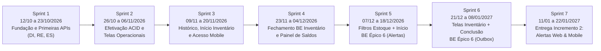

# Planejamento de sprints e roadmap de desenvolvimento: FarmaUBS

## 1. Visão geral, capacidade e reordenação de incrementos

Este documento define o cronograma de sprints para implementar os épicos do **Incremento 1** — Dispensação (Épico 2), Recebimento (Épico 3), Controle de Estoque (Épico 4) e Inventário Mensal (Épico 5) — e do **Novo Incremento 2** — Alertas, Notificações e Parâmetros Operacionais (Épico 6), além da trilha dedicada ao Aplicativo Mobile (`apps/mobile`). Ele toma como base os requisitos canônicos ([farmaubs-requisitos.md](./documento-requisitos/farmaubs-requisitos.md)), a concepção do projeto ([FARMAUBS.md](./onboarding/FARMAUBS.md)), as decisões da entrevista de 29/09/2026 e os registros de arquitetura (ADRs).

> ### 📌 Decisão Estratégica de Reordenação (Incremento 3 ➔ Novo Incremento 2)
> Na concepção inicial do projeto, a camada de inteligência gerencial avançada (Curva ABC dinâmica e relatórios gerenciais multi-período) constituía o Incremento 2, enquanto o **Módulo de Alertas e Notificações (`RF022`, `RF023`, `RF024`, `RF027`)** era o Incremento 3.
> 
> Como **não existe dependência cronológica ou técnica** entre os dois incrementos — uma vez que o motor de alertas depende apenas dos saldos de lotes (`lotes`), dispensações (`dispensacoes`) e parâmetros da UBS já entregues no Incremento 1 — e o escopo de alertas é significativamente mais enxuto e rápido de entregar, **o Módulo de Alertas foi promovido para o Incremento 2 (Épico 6)**. Isso antecipa a proteção ativa contra vencimentos e rupturas na UBS sem aguardar a construção dos relatórios analíticos pesados (que passam a compor o Incremento 3, seguidos da Previsão de Demanda e Sugestão de Pedido Mensal no Incremento 4).

| Parâmetro | Definição |
| --- | --- |
| Início | 12 de outubro de 2026 |
| Duração da sprint | 2 semanas (10 dias úteis) |
| Equipe backend | 3 desenvolvedores (Dev BE 1, Dev BE 2, Dev BE 3) |
| Equipe frontend web | 1 desenvolvedor (Dev FE) |
| Equipe mobile | 1 desenvolvedor (Dev MOB — esteira paralela em `apps/mobile`) |
| Organização backend | Cada desenvolvedor backend assume um épico em paralelo |
| Organização frontend / mobile | Consomem as APIs REST prontas e compartilham contratos via `@farmaubs/shared` |
| Ritmo estimado | 2 a 3 histórias por desenvolvedor a cada sprint |
| Volume total mapeado | **48 histórias Web/Backend** (22 Backend e 22 Frontend nos Épicos 2 a 6) + **trilha Mobile** em 7 sprints |

---

## 2. Linha do tempo e cronograma das sprints

| Sprint | Período | Incremento | Foco principal |
| --- | --- | --- | --- |
| **Sprint 1** | 12/10/2026 a 23/10/2026 | Incremento 1 | Schemas, migrações, catálogo e consultas básicas (DI, RE, ES), além dos formulários iniciais de tela |
| **Sprint 2** | 26/10/2026 a 06/11/2026 | Incremento 1 | Transações de dispensação, entrada e ajuste, junto com conferência de recebimento e seleção FEFO |
| **Sprint 3** | 09/11/2026 a 20/11/2026 | Incremento 1 | Histórico com filtro ontem/hoje, backend de inventário, telas de dispensação/recebimento e Épico 1 Mobile (`AC-MOB-01..07`) |
| **Sprint 4** | 23/11/2026 a 04/12/2026 | Incremento 1 | Fechamento do backend de inventário, painel de histórico de dispensas e tabela de saldos com alerta laranja |
| **Sprint 5** | 07/12/2026 a 18/12/2026 | Incremento 1 + Inc. 2 (BE) | Filtros/modais de estoque no frontend e início do backend do **Épico 6 — Alertas** (`AL-01`, `AL-02`) aproveitando a capacidade liberada do time BE |
| **Sprint 6** | 21/12/2026 a 08/01/2027 | Incremento 1 + Inc. 2 (BE) | Telas de inventário mensal (`IN-05..08`) e conclusão do backend do **Épico 6 — Alertas e Worker Outbox** (`AL-03`, `AL-04`) |
| **Sprint 7** | 11/01/2027 a 22/01/2027 | **Novo Incremento 2** | Entrega completa das telas Web (`AL-05..08`) e Mobile (`AL-MOB-01..04`) do **Épico 6 (Alertas, Notificações e Parâmetros da UBS)** |

---

## 3. Detalhamento sprint a sprint

### Sprint 1: Fundação de schemas, catálogo e primeiras APIs
**Período:** 12 de outubro de 2026 a 23 de outubro de 2026  
**Meta:** Rodar as migrações básicas de dispensação e recebimento, liberar endpoints de catálogo/pacientes e montar os formulários iniciais.

#### Backend
- Dev BE 1: Épico 2 (Dispensação)
  - [`DI-01`](./historias-usuario/2-epico-dispensacao-de-medicamentos/di-01-backend-migrations-schema-dispensacao.md): Migrações do schema de dispensação (`pacientes`, `dispensacoes`, `dispensacao_itens` e movimentações).
  - [`DI-02`](./historias-usuario/2-epico-dispensacao-de-medicamentos/di-02-backend-api-pacientes-cadastro-historico.md): API de Pacientes com validação obrigatória (CNS, CPF, nome e nascimento) e histórico de consumo.
  - [`DI-03`](./historias-usuario/2-epico-dispensacao-de-medicamentos/di-03-backend-api-dispensacao-busca-produtos-lotes-fefo.md): API de Dispensação com busca textual e ordenação FEFO.
- Dev BE 2: Épico 3 (Recebimento)
  - [`RE-01`](./historias-usuario/3-epico-recebimento-de-medicamentos/re-01-backend-migrations-schema-recebimento.md): Migrações do schema de recebimento (`documentos_entrada`, `recebimento_itens`, `lotes`, `fabricantes` e movimentações).
  - [`RE-02`](./historias-usuario/3-epico-recebimento-de-medicamentos/re-02-backend-api-catalogo-busca-produtos-fabricantes.md): API de Catálogo com busca textual de produtos e gestão de fabricantes.
- Dev BE 3: Épico 4 (Controle de Estoque)
  - [`ES-01`](./historias-usuario/4-epico-controle-de-estoque/es-01-backend-api-analitica-metricas-criticidade-estoque.md): API Analítica com métricas de criticidade, totalizadores, cálculo de ruptura e validade curta.
  - [`ES-02`](./historias-usuario/4-epico-controle-de-estoque/es-02-backend-api-saldos-consulta-paginada-filtros.md): API de Saldos com paginação, categorias, lotes e filtros de status.

#### Frontend
- Dev FE: Formulários de entrada e identificação
  - [`RE-05`](./historias-usuario/3-epico-recebimento-de-medicamentos/re-05-frontend-formulario-recebimento-cabecalho-guia.md): Cabeçalho do recebimento com número do documento/guia CAF, seleção de origem e validações.
  - [`DI-06`](./historias-usuario/2-epico-dispensacao-de-medicamentos/di-06-frontend-identificacao-paciente-formulario-historico.md): Formulário de identificação do paciente (CNS, CPF, nome e nascimento) e histórico.

---

### Sprint 2: Transações atômicas de efetivação e telas de conferência
**Período:** 26 de outubro de 2026 a 06 de novembro de 2026  
**Meta:** Concluir as regras de entrada e saída de estoque com consistência ACID no backend e conectar conferência física e seleção FEFO no frontend.

#### Backend
- Dev BE 1: Épico 2 (Dispensação)
  - [`DI-04`](./historias-usuario/2-epico-dispensacao-de-medicamentos/di-04-backend-api-efetivacao-transacao-baixa-estoque.md): API de Efetivação com baixa transacional de estoque e validação de antimicrobianos.
  - [`DI-05`](./historias-usuario/2-epico-dispensacao-de-medicamentos/di-05-backend-api-historico-dispensas-filtro-ontem-hoje-exportacao-xlsx.md): API de Histórico com listagem temporal (padrão ontem/hoje, intervalo customizado) e exportação em XLSX.
  *Backend do Épico 2 concluído.*
- Dev BE 2: Épico 3 (Recebimento)
  - [`RE-03`](./historias-usuario/3-epico-recebimento-de-medicamentos/re-03-backend-api-efetivacao-transacao-entrada-estoque.md): API de Efetivação com entrada atômica, criação/incremento de lotes e log de auditoria.
  - [`RE-04`](./historias-usuario/3-epico-recebimento-de-medicamentos/re-04-backend-api-historico-recebimentos-estorno.md): API de Histórico com filtro padrão ontem/hoje, comprovante, estorno e exportação em XLSX.
  *Backend do Épico 3 concluído.*
- Dev BE 3: Épico 4 (Controle de Estoque)
  - [`ES-03`](./historias-usuario/4-epico-controle-de-estoque/es-03-backend-api-ajustes-estoque-transacao-justificada.md): API de Ajustes operacionais com motivo, justificativa e auditoria.
  - [`ES-04`](./historias-usuario/4-epico-controle-de-estoque/es-04-backend-api-rastreabilidade-historico-lote.md): API de Rastreabilidade com linha do tempo de movimentações por lote.

#### Frontend
- Dev FE: Conferência e catálogo
  - [`DI-07`](./historias-usuario/2-epico-dispensacao-de-medicamentos/di-07-frontend-busca-textual-medicamentos-seletor-lotes-fefo.md): Busca textual de medicamentos e seletor FEFO com avisos de índice terapêutico.
  - [`RE-06`](./historias-usuario/3-epico-recebimento-de-medicamentos/re-06-frontend-busca-textual-medicamentos-fabricante-lote.md): Busca no catálogo, fabricante obrigatório, lote e avisos de validade.
  - [`RE-07`](./historias-usuario/3-epico-recebimento-de-medicamentos/re-07-frontend-confirmacao-entrada-sincronizacao-estoque.md): Submissão da entrada e atualização imediata do estoque.

---

### Sprint 3: Início do inventário mensal, carrinho, painel de recebimento e Acesso Mobile
**Período:** 09 de novembro de 2026 a 20 de novembro de 2026  
**Meta:** Iniciar o backend de inventário (Épico 5), finalizar a exportação do estoque, fechar as telas do Épico 3 e entregar o Épico 1 no Mobile (`AC-MOB-01` a `AC-MOB-07`).

#### Backend
- Dev BE 1: Épico 5 (Inventário Mensal)
  - [`IN-01`](./historias-usuario/5-epico-inventario-mensal/in-01-backend-migrations-schema-inventario.md): Migrações do schema de inventário (`ciclos_inventario`, `inventario_itens`, `atas_inventario` e movimentações).
  - [`IN-02`](./historias-usuario/5-epico-inventario-mensal/in-02-backend-api-ciclos-iniciar-snapshot-status.md): API de Ciclos com foto do saldo teórico, rascunho persistente e controle de status.
- Dev BE 2: Apoio ao Épico 4 e relatórios
  - [`ES-05`](./historias-usuario/4-epico-controle-de-estoque/es-05-backend-api-relatorios-exportacao-planilha-xlsx.md): API de Relatórios com download de planilha XLSX por período, princípio ativo e perdas.
  *Backend do Épico 4 concluído.*
- Dev BE 3: Concorrência e isolamento
  - Testes de concorrência nos ajustes de estoque (ES-03/ES-04) e apoio nas regras do Épico 5.

#### Frontend Web e Mobile
- Dev FE: Atendimento e histórico de entradas
  - [`DI-08`](./historias-usuario/2-epico-dispensacao-de-medicamentos/di-08-frontend-carrinho-receita-posologia-antimicrobianos.md): Carrinho de dispensação com múltiplos itens, posologia e checagem de receita antimicrobiana.
  - [`DI-09`](./historias-usuario/2-epico-dispensacao-de-medicamentos/di-09-frontend-tela-principal-dispensacao-fechamento-atendimento.md): Tela principal de dispensação integrando o atendimento e a baixa física.
  - [`RE-08`](./historias-usuario/3-epico-recebimento-de-medicamentos/re-08-frontend-tabela-ultimos-recebimentos-termo-estorno.md): Histórico de recebimentos com visualização ontem/hoje, intervalo customizado, exportação em XLSX, termo impresso e estorno.  
  *Épico 3 (Recebimento) concluído no backend e no frontend.*
- Dev MOB: Épico 1 Mobile (Acesso e Autenticação)
  - [`AC-MOB-01` a `AC-MOB-07`](./historias-usuario/1-epico-acesso-e-autenticacao-do-sistema/PROGRESSO.md): Login, sessão segura em Keystore, seletor de UBS ativa, troca de senha provisória, logout, banner de conectividade e alerta nativo de inatividade.  
  *Épico 1 concluído no Mobile.*

---

### Sprint 4: Fechamento do backend de inventário e tabela de saldos
**Período:** 23 de novembro de 2026 a 04 de dezembro de 2026  
**Meta:** Entregar o restante do backend de inventário, finalizar o frontend de dispensação e iniciar o painel de saldos com alerta laranja.

#### Backend
- Dev BE 1: Épico 5 (Inventário Mensal)
  - [`IN-03`](./historias-usuario/5-epico-inventario-mensal/in-03-backend-api-contagem-divergencias-justificativas-outros.md): API de Contagem com cálculo de sobras/faltas e validação da justificativa Outros.
  - [`IN-04`](./historias-usuario/5-epico-inventario-mensal/in-04-backend-api-homologacao-ajuste-saldos-ata-relatorio-xlsx.md): API de Homologação com acerto de saldos, geração de Ata Oficial e exportação em XLSX.  
  *Backends do Incremento 1 (Épicos 2 a 5) 100% entregues.*
- Dev BE 2 e Dev BE 3: Testes de ponta a ponta
  - Testes cobrindo entrada na UBS, saldo em estoque, dispensa ao paciente e inventário com divergências.
  - Verificação de Row-Level Security para impedir vazamento entre unidades.

#### Frontend
- Dev FE: Histórico de dispensação e saldos
  - [`DI-10`](./historias-usuario/2-epico-dispensacao-de-medicamentos/di-10-frontend-painel-historico-dispensas-filtros-exportacao-xlsx.md): Painel de histórico de dispensas com filtro ontem/hoje, busca e exportação em XLSX.  
    *Épico 2 (Dispensação) concluído no backend e no frontend.*
  - [`ES-06`](./historias-usuario/4-epico-controle-de-estoque/es-06-frontend-dashboard-cards-metricas-criticidade.md): Cartões superiores de métricas (totalizadores, baixo estoque e vencimento próximo).
  - [`ES-07`](./historias-usuario/4-epico-controle-de-estoque/es-07-frontend-tabela-saldos-lotes-destaque-validade-laranja.md): Tabela de saldos por medicamento, expansão de lotes e destaque visual laranja.

---

### Sprint 5: Fechamento de estoque no frontend e início do Backend do Épico 6 (Alertas)
**Período:** 07 de dezembro de 2026 a 18 de dezembro de 2026  
**Meta:** Finalizar o controle de estoque no frontend (filtros do mês corrente, modais de ajuste e exportação XLSX) e iniciar a fundação backend do **Novo Incremento 2 (Épico 6: Alertas e Parâmetros)**.

#### Backend (Novo Incremento 2 — Épico 6)
- Dev BE 1: Schema e Parâmetros Operacionais
  - [`AL-01`](./historias-usuario/6-epico-alertas-e-notificacoes/al-01-backend-migrations-schema-alertas-parametros-outbox.md): Migrações das tabelas `parametros_operacionais_ubs`, `alertas_estoque` e `outbox_events` com políticas RLS.
  - [`AL-02`](./historias-usuario/6-epico-alertas-e-notificacoes/al-02-backend-api-parametros-operacionais-ubs.md): API de Parâmetros Operacionais da UBS (`RF027`) com validação RBAC, log de auditoria (`RF028`) e gatilho de recálculo.
- Dev BE 2 e Dev BE 3: Apoio na integração com o frontend de Estoque e contratos `@farmaubs/shared` de Alertas.

#### Frontend
- Dev FE: Fechamento de estoque
  - [`ES-08`](./historias-usuario/4-epico-controle-de-estoque/es-08-frontend-barra-filtros-avancados-validade-mes-corrente.md): Barra de filtros com busca textual, vencimento no mês corrente e categorias REMUME.
  - [`ES-09`](./historias-usuario/4-epico-controle-de-estoque/es-09-frontend-modal-ajustes-rapidos-ficha-rastreabilidade.md): Ficha de rastreabilidade do lote e modal de ajuste rápido justificado.
  - [`ES-10`](./historias-usuario/4-epico-controle-de-estoque/es-10-frontend-interface-exportacao-relatorios-consumo-saldos.md): Seleção de período, filtros e download da planilha XLSX.  
  *Épico 4 (Controle de Estoque) concluído no backend e no frontend.*

---

### Sprint 6: Telas de inventário mensal e conclusão do Backend do Épico 6 (Motor de Alertas e Outbox)
**Período:** 21 de dezembro de 2026 a 08 de janeiro de 2027 (inclui o recesso de fim de ano)  
**Meta:** Entregar as telas de inventário físico no frontend (fechando o Incremento 1) e concluir o motor de avaliação de alertas e o worker Outbox no backend.

#### Backend (Novo Incremento 2 — Épico 6)
- Dev BE 2: Motor de Alertas
  - [`AL-03`](./historias-usuario/6-epico-alertas-e-notificacoes/al-03-backend-motor-avaliacao-alertas-vencimento-ruptura-api.md): Motor de avaliação de vencimento próximo (`RF022`) e cobertura em dias para risco de ruptura (`RF023`), auto-resolução e endpoints REST de consulta e leitura.
- Dev BE 3: Outbox e Notificações por E-mail
  - [`AL-04`](./historias-usuario/6-epico-alertas-e-notificacoes/al-04-backend-worker-outbox-notificacoes-email.md): Worker do *Transactional Outbox* (`ADR-004`) com deduplicação diária e envio de e-mail ao Farmacêutico Responsável.  
  *Backend do Épico 6 (Novo Incremento 2) concluído.*

#### Frontend
- Dev FE: Módulo de inventário
  - [`IN-05`](./historias-usuario/5-epico-inventario-mensal/in-05-frontend-tela-visao-geral-historico-ciclos.md): Visão geral dos ciclos realizados, status do ciclo ativo e botão de início.
  - [`IN-06`](./historias-usuario/5-epico-inventario-mensal/in-06-frontend-formulario-contagem-fisica-busca-autosave.md): Formulário de contagem física por lote com busca e salvamento automático.
  - [`IN-07`](./historias-usuario/5-epico-inventario-mensal/in-07-frontend-mapa-conciliacao-divergencias-seletor-outros.md): Mapa de conciliação com divergências em tempo real, seleção de motivos e justificativa para Outros.
  - [`IN-08`](./historias-usuario/5-epico-inventario-mensal/in-08-frontend-modal-homologacao-ata-impressao-exportacao-xlsx.md): Modal de homologação, impressão da Ata Oficial com estilo de impressão e exportação em XLSX.  
  *Épico 5 (Inventário Mensal) e totalidade do Incremento 1 concluídos.*

---

### Sprint 7: Entrega do Novo Incremento 2 — Alertas, Notificações e Parâmetros (Web e Mobile)
**Período:** 11 de janeiro de 2027 a 22 de janeiro de 2027  
**Meta:** Entregar todas as interfaces Web e Mobile do **Épico 6 (Alertas, Notificações e Parâmetros Operacionais)** e homologar o Novo Incremento 2 junto aos farmacêuticos parceiros.

#### Backend
- Equipe backend (Dev BE 1, Dev BE 2, Dev BE 3)
  - Testes integrados E2E do gatilho transacional entre Recebimento/Dispensação/Inventário e o Motor de Alertas + Outbox.
  - Seed de lotes em faixa de atenção/crítico e medicamentos em risco de ruptura na UBS de Parnaíba para demonstração.

#### Frontend Web
- Dev FE: Central de Alertas e Parâmetros Operacionais
  - [`AL-05`](./historias-usuario/6-epico-alertas-e-notificacoes/al-05-frontend-sino-notificacoes-header-drawer-resumo.md): Sino de notificações no cabeçalho com badge de não lidos e gaveta rápida.
  - [`AL-06`](./historias-usuario/6-epico-alertas-e-notificacoes/al-06-frontend-central-alertas-abas-vencimento-ruptura.md): Tela Central de Alertas em duas abas ("Próximos ao Vencimento" e "Risco de Ruptura") e atalhos operacionais.
  - [`AL-07`](./historias-usuario/6-epico-alertas-e-notificacoes/al-07-frontend-modal-pagina-configuracao-parametros-ubs.md): Modal/Tela de configuração de parâmetros operacionais da UBS (`RF027`) com simulador de ponto de pedido.
  - [`AL-08`](./historias-usuario/6-epico-alertas-e-notificacoes/al-08-frontend-widget-alertas-ativos-dashboard-confirmacao-validade-curta.md): Widget de alertas no Dashboard e confirmação bloqueante para recebimento de lotes com validade curta (`< 6 meses`, `RF024`).

#### Mobile (`apps/mobile`)
- Dev MOB: Alertas e Notificações Nativas no Celular
  - [`AL-MOB-01`](./historias-usuario/6-epico-alertas-e-notificacoes/al-mob-01-central-alertas-vencimento-ruptura-mobile.md): Central de Alertas no celular com abas de vencimento e ruptura e marcação de leitura por toque.
  - [`AL-MOB-02`](./historias-usuario/6-epico-alertas-e-notificacoes/al-mob-02-notificacoes-push-locais-alertas-criticos-mobile.md): Notificações locais nativas (`expo-notifications`) para novos alertas críticos na UBS ativa.
  - [`AL-MOB-03`](./historias-usuario/6-epico-alertas-e-notificacoes/al-mob-03-configuracao-parametros-operacionais-ubs-mobile.md): Configuração rápida de parâmetros operacionais da UBS pelo celular (`RF027`).
  - [`AL-MOB-04`](./historias-usuario/6-epico-alertas-e-notificacoes/al-mob-04-alerta-bloqueante-recebimento-validade-curta-mobile.md): Folha modal bloqueante de confirmação no recebimento de lotes com validade curta (`< 6 meses`, `RF024`).  
  *Épico 6 (Novo Incremento 2) 100% concluído no Backend, Frontend Web e Mobile.*

---

## 4. Matriz de entregas por sprint e desenvolvedor (Épicos 2 a 6)

| Sprint | Dev BE 1 | Dev BE 2 | Dev BE 3 | Dev FE | Dev MOB | Total (BE + FE) |
| --- | --- | --- | --- | --- | --- | --- |
| **Sprint 1** (12/10 a 23/10) | DI-01, DI-02, DI-03 | RE-01, RE-02 | ES-01, ES-02 | RE-05, DI-06 | Fundação Expo | 9 histórias |
| **Sprint 2** (26/10 a 06/11) | DI-04, DI-05 | RE-03, RE-04 | ES-03, ES-04 | DI-07, RE-06, RE-07 | AC-MOB-01..03 | 9 histórias |
| **Sprint 3** (09/11 a 20/11) | IN-01, IN-02 | ES-05 e testes RE | Concorrência e RLS | DI-08, DI-09, RE-08 | AC-MOB-04..07 | 6 histórias |
| **Sprint 4** (23/11 a 04/12) | IN-03, IN-04 | Testes E2E Inc. 1 | Testes concorrência | DI-10, ES-06, ES-07 | DI-MOB / RE-MOB | 5 histórias |
| **Sprint 5** (07/12 a 18/12) | **AL-01, AL-02** | Apoio UI Estoque | Contratos Shared AL | ES-08, ES-09, ES-10 | ES-MOB | 5 histórias |
| **Sprint 6** (21/12 a 08/01) | Revisão e Seeds | **AL-03** | **AL-04** | IN-05, IN-06, IN-07, IN-08 | IN-MOB | 6 histórias |
| **Sprint 7** (11/01 a 22/01) | Testes E2E Alertas | Otimização Outbox | Homologação Geral | **AL-05, AL-06, AL-07, AL-08** | **AL-MOB-01..04** | 4 histórias (+4 MOB) |
| **Totais** | **9 histórias BE** | **6 histórias BE** | **5 histórias BE** | **22 histórias FE** | **Épicos Mobile** | **44 histórias BE/FE** |

---

## 5. Rastreabilidade das entregas por épico e incremento

| Incremento | Épico | Conclusão Backend | Conclusão Frontend Web | Conclusão Mobile | Situação |
| --- | --- | --- | --- | --- | --- |
| **Incremento 1** | Épico 1: Acesso e Autenticação | Concluído | Concluído | Sprint 3 (20/11/2026) | ✅ Concluído em todas as camadas |
| **Incremento 1** | Épico 3: Recebimento de Medicamentos | Sprint 2 (06/11/2026) | Sprint 3 (20/11/2026) | Trilha Contínua | ✅ Concluído no BE e Web |
| **Incremento 1** | Épico 2: Dispensação de Medicamentos | Sprint 2 (06/11/2026) | Sprint 4 (04/12/2026) | Trilha Contínua | ✅ Concluído no BE e Web |
| **Incremento 1** | Épico 4: Controle de Estoque | Sprint 3 (20/11/2026) | Sprint 5 (18/12/2026) | Trilha Contínua | 🚧 Em finalização |
| **Incremento 1** | Épico 5: Inventário Mensal | Sprint 4 (04/12/2026) | Sprint 6 (08/01/2027) | Trilha Contínua | 📋 Planejado |
| **Novo Incremento 2** | **Épico 6: Alertas, Notificações e Parâmetros** | **Sprint 6 (08/01/2027)** | **Sprint 7 (22/01/2027)** | **Sprint 7 (22/01/2027)** | 📋 **Antecipado e Especificado** |
| **Incremento 3 (Futuro)** | Inteligência Gerencial Avançada e Curva ABC | Período 3 | Período 3 | Período 3 | 🔜 Próximo Incremento |
| **Incremento 4 (Futuro)** | Previsão de Demanda e Sugestão de Pedido CAF | Período 3 | Período 3 | Período 3 | 🔜 Planejado |

---

## 6. Governança e rotina da equipe

1. Planejamento da sprint (segunda-feira, 09h): Seleção e alinhamento dos itens com base no que foi entregue na sprint anterior e em novas necessidades dos profissionais.
2. Alinhamento diário assíncrono (15 minutos): Comunicação rápida entre frontend, mobile e backends para conferir contratos de API (`@farmaubs/shared`, Swagger e mocks).
3. Demonstração da sprint (sexta-feira, 16h): Apresentação das telas e rotas finalizadas no ambiente de testes.
4. Retrospectiva: Registro de pontos de melhoria, planejamento de novas histórias e atualização do [MAPA_HISTORIAS.md](./historias-usuario/MAPA_HISTORIAS.md) e dos arquivos de progresso de cada épico.
