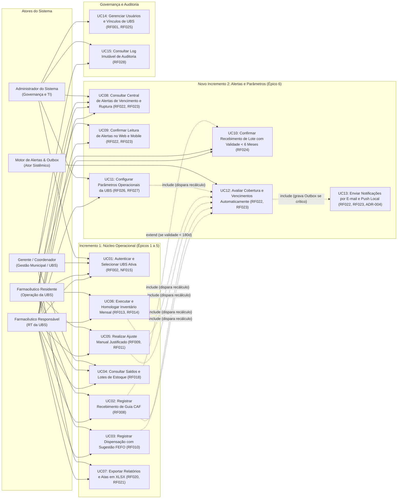
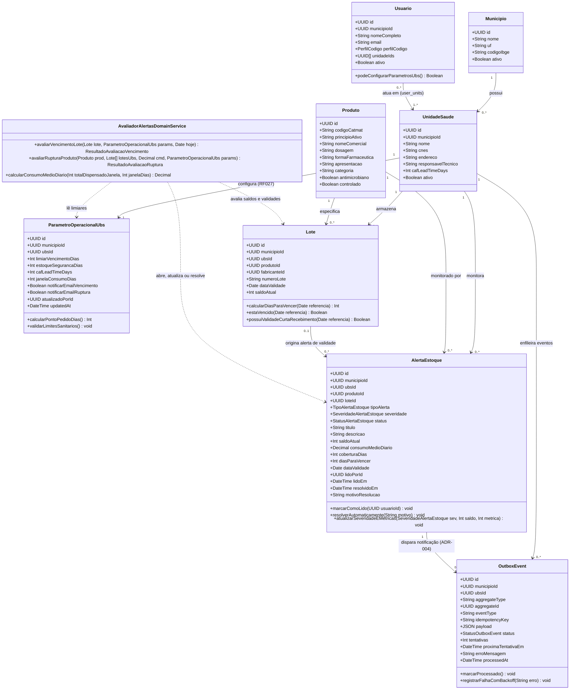
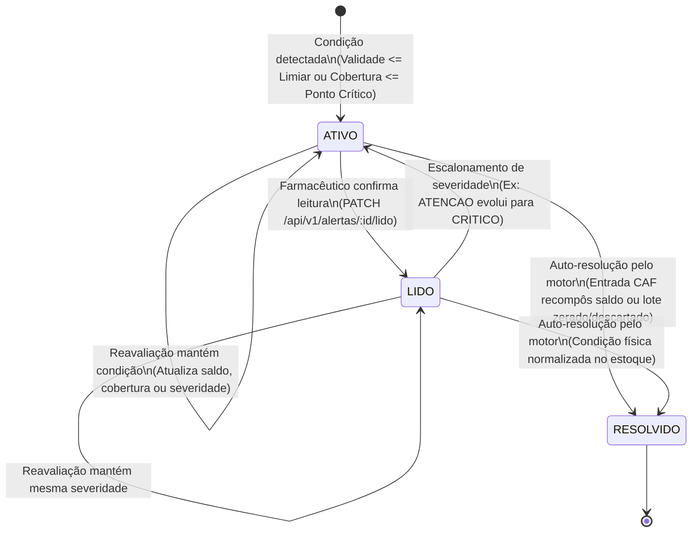

# Diagramas UML: Casos de Uso, Classes de Domínio e Ciclo de Estados (FarmaUBS)

Este documento consolida a modelagem conceitual UML do FarmaUBS atualizada para contemplar o **Incremento 1** (Acesso, Recebimento, Dispensação, Controle de Estoque e Inventário Mensal) e o **Novo Incremento 2 — Épico 6: Alertas, Notificações e Parâmetros Operacionais** (`RF022`, `RF023`, `RF024`, `RF026`, `RF027`, `RF028`).

---

## 1. Diagrama de Casos de Uso por Perfil de Acesso (RBAC)

O diagrama abaixo mapeia os quatro perfis canônicos do sistema (`FARMACEUTICO_RESPONSAVEL`, `FARMACEUTICO_RESIDENTE`, `GERENTE` e `ADMINISTRADOR`) e o ator sistêmico (`Worker Outbox / Job Diário`) frente aos casos de uso operacionais e de monitoramento ativo.

---

## 2. Detalhamento dos Casos de Uso do Épico 6 (Alertas e Notificações)

| Código | Caso de Uso | Atores Primários | Requisitos | Regra Síntese |
| --- | --- | --- | --- | --- |
| **UC08** | Consultar Central de Alertas (Vencimento e Ruptura) | Todos os perfis da UBS | RF022, RF023 | Exibe alertas divididos nas abas "Próximos ao Vencimento" e "Risco de Ruptura", ordenados por severidade (`CRITICO`, `ATENCAO`). |
| **UC09** | Confirmar Leitura de Alertas | Farmacêutico RT, Residente | RF022, RF023 | Transiciona o alerta de `ATIVO` para `LIDO`, atualizando o contador do sino no cabeçalho Web e do badge no App Mobile. |
| **UC10** | Confirmar Recebimento de Lote com Validade Curta | Farmacêutico RT, Residente | RF024, RF028 | Caso de uso `<<extend>>` de `UC02`: bloqueia a entrada de lotes com validade $< 180$ dias até que o profissional marque ciência explícita, registrando auditoria. |
| **UC11** | Configurar Parâmetros Operacionais da UBS | Farmacêutico RT, Administrador | RF026, RF027, RF028 | Altera `limiarVencimentoDias`, `estoqueSegurancaDias`, `cafLeadTimeDays` e preferências de e-mail da UBS, disparando recálculo imediato (`UC12`) e auditoria. |
| **UC12** | Avaliar Cobertura e Vencimentos Automaticamente | Sistema / Gatilho Transacional | RF022, RF023, ADR-010 | Calcula a validade de cada lote ativo e a cobertura consolidada por medicamento ($\text{Saldo Válido} / \text{CMD}$), abrindo novos alertas ou auto-resolvendo os normalizados. |
| **UC13** | Enviar Notificações por E-mail e Push Local | Worker Outbox / App Mobile | RF022, RF023, ADR-004 | Consome `outbox_events` com idempotência diária para enviar e-mail ao Farmacêutico Responsável e dispara notificação local no celular via `expo-notifications`. |

---

## 3. Diagrama de Classes de Domínio (UML `classDiagram`)

O diagrama de classes abaixo representa o modelo de domínio rico do FarmaUBS, destacando em especial as entidades, objetos de valor e serviços de domínio introduzidos pelo **Épico 6 (Incremento 2)** e sua integração com o núcleo operacional do **Incremento 1**.

---

## 4. Diagrama de Estados do Ciclo de Vida do Alerta (`stateDiagram-v2`)

