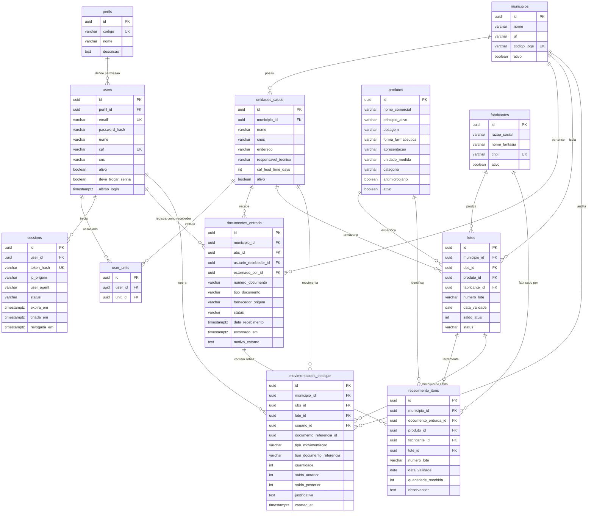

# Modelo de dados e diagrama relacional (FarmaUBS)

Este documento apresenta a estrutura unificada das tabelas do banco de dados PostgreSQL do FarmaUBS, incluindo chaves primárias, chaves estrangeiras, restrições de integridade e políticas de Row-Level Security (RLS).

---

## 1. Diagrama de entidade e relacionamento (ER)

---

## 2. Tabelas e regras de negócio no banco de dados

### Catálogo e administração
- **`municipios`:** Cidades atendidas pelo sistema. Chave natural `codigo_ibge`.
- **`unidades_saude`:** Unidades Básicas de Saúde (UBSs) vinculadas ao município. Possui CNES e prazo médio de entrega da CAF (`caf_lead_time_days`).
- **`perfis`:** Perfis RBAC do sistema: `ADMINISTRADOR`, `GERENTE`, `FARMACEUTICO_RESPONSAVEL`, `FARMACEUTICO_RESIDENTE`.
- **`users`:** Operadores do sistema com hash bcrypt de senha e flags de segurança (`deve_trocar_senha`).
- **`user_units`:** Associação N:N entre usuários e as UBSs em que possuem autorização de atuação.
- **`sessions`:** Controle de sessão server-side. Armazena hash SHA-256 do token para revogação rápida e expiração deslizante.

### Catálogo farmacêutico e estoque
- **`produtos`:** Medicamentos e insumos da Relação Municipal de Medicamentos Essenciais (REMUME). Índices textuais em `lower(principio_ativo)` e `lower(nome_comercial)`.
- **`fabricantes`:** Laboratórios farmacêuticos fornecedores com CNPJ único e busca em `lower(nome_fantasia)`.
- **`lotes`:** Registro do saldo físico por UBS. Restrição de unicidade composta `uq_lotes_ubs_produto_lote_fabricante` e checagem de saldo não negativo (`saldo_atual >= 0`).

### Recebimento e rastreabilidade
- **`documentos_entrada`:** Cabeçalho da remessa física (Guia CAF ou Nota Fiscal) com origem, número, data de conferência e status (`CONCLUIDO` ou `ESTORNADO`).
- **`recebimento_itens`:** Linhas da guia com quantidade positiva conferida, fabricante, lote e validade.
- **`movimentacoes_estoque`:** Livro-razão imutável de movimentação. Registra `ENTRADA_RECEBIMENTO`, `SAIDA_DISPENSACAO`, `ESTORNO_ENTRADA` e ajustes com saldo anterior e posterior para auditoria.

---

## 3. Políticas de Row-Level Security (RLS)

O isolamento de dados no PostgreSQL (ADR-002, ADR-016) é aplicado por município e por unidade de saúde:

| Tabela | Variável de sessão PostgreSQL | Regra de visibilidade |
| --- | --- | --- |
| `documentos_entrada` | `app.municipio_id` / `app.current_ubs_id` | Visível apenas para o município e a UBS ativa na requisição |
| `recebimento_itens` | `app.municipio_id` | Vinculada ao escopo do município do documento de entrada |
| `lotes` | `app.municipio_id` / `app.current_ubs_id` | Saldo isolado estritamente por UBS |
| `movimentacoes_estoque` | `app.municipio_id` / `app.current_ubs_id` | Livro-razão isolado por UBS |
| `users` | `app.municipio_id` | Administradores municipais enxergam apenas usuários da sua lotação |
