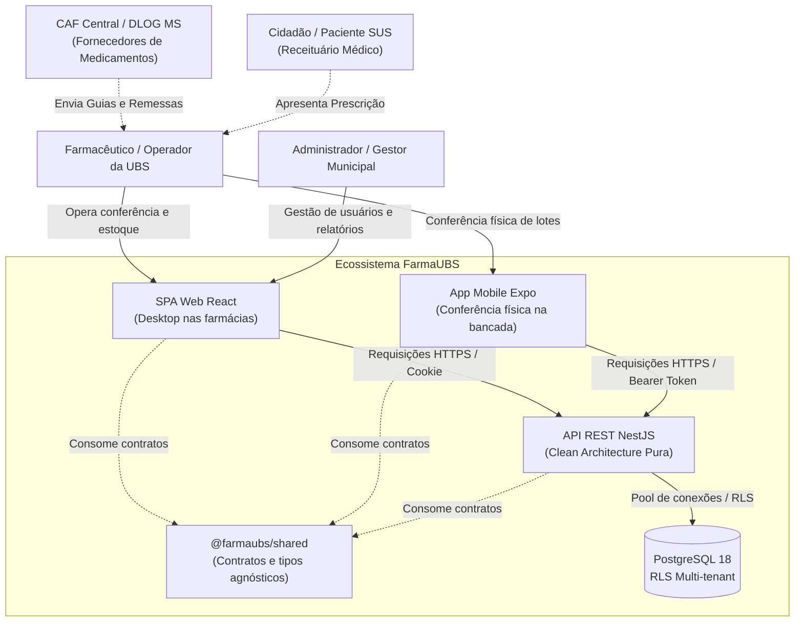
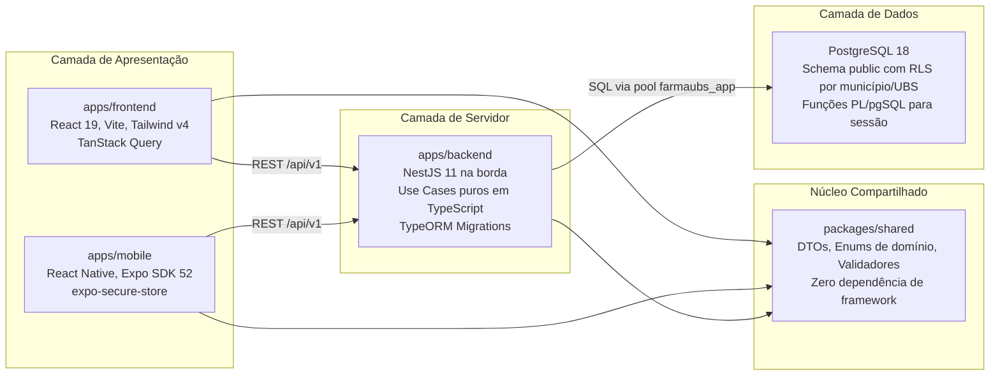
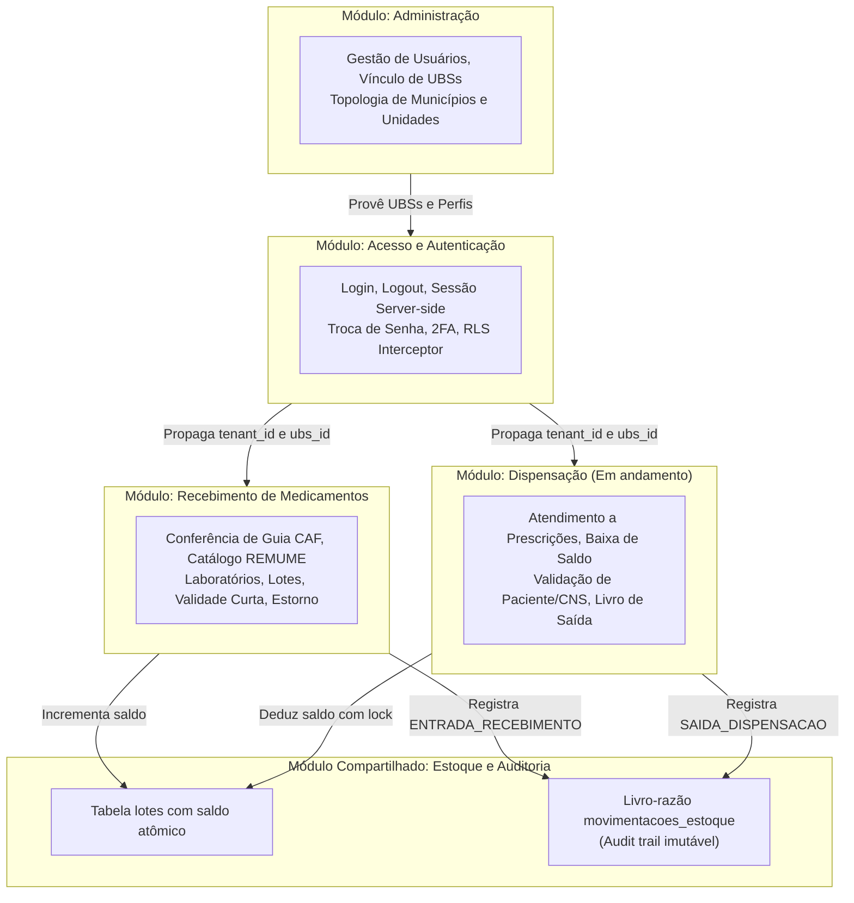

# Arquitetura do sistema e mapa de módulos (FarmaUBS)

Este documento descreve a visão geral da arquitetura de software, o modelo de contexto dos clientes e servidores, e as fronteiras dos módulos de domínio do FarmaUBS.

---

## 1. Visão de contexto (C4 - nível 1)

O FarmaUBS opera no contexto da Atenção Primária à Saúde (SUS), atendendo as farmácias das Unidades Básicas de Saúde (UBS) e almoxarifados municipais de saúde (CAF).

---

## 2. Visão de containers (C4 - nível 2)

O monorepo divide as responsabilidades em workspaces independentes conectados pelo Moonrepo:

---

## 3. Módulos de domínio (Bounded Contexts)

O backend organiza as regras de negócio em módulos verticais com Clean Architecture clássica:

---

## 4. Regras de comunicação e fronteiras arquiteturais

1. **Pureza do Domínio (ADR-003, ADR-033):**
   - Use cases e entidades não conhecem NestJS, TypeORM, Express ou React.
   - Qualquer dependência externa é invertida através de portas (interfaces em `domain/ports/`).
2. **Isolamento de Escopo (ADR-035):**
   - Frontend web e backend nunca compartilham código de infraestrutura.
   - Todo tipo que trafega pela rede deve ser declarado em `packages/shared/src/<modulo>/<recurso>.types.ts`.
3. **Segurança Multi-tenant (ADR-002, ADR-016):**
   - Cada requisição autenticada define o contexto via `SET LOCAL app.municipio_id` e `SET LOCAL app.current_ubs_id`.
   - O PostgreSQL impede vazamento de dados entre UBSs ou municípios distintos via Row-Level Security nativo.
