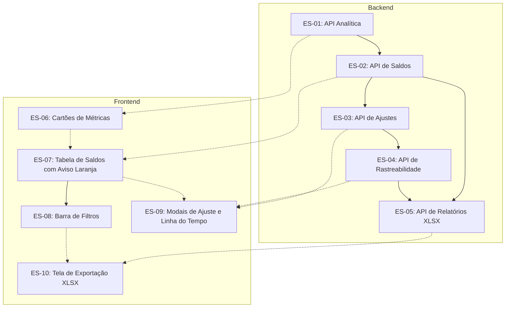

# Controle de Estoque (RF005, RF006, RF007, RF009, RF011, RF018, RF020, RF022, RF023, RF028, NF001, NF002, NF003, NF007, NF009, NF015)

## Visão geral do épico e história de usuário

> **Como** farmacêutico responsável ou gerente de farmácia da UBS,  
> **quero** um painel para acompanhar os saldos do estoque por medicamento e lote, com cartões de indicadores, aviso em laranja para itens que vencem no mês corrente ou em 90 dias, ficha de histórico de movimentação por lote, diálogo de ajustes rápidos (+/-) com justificativa e exportação de relatórios em planilha Excel (.xlsx),  
> **para que** eu possa acompanhar o abastecimento da unidade, agir antes que os medicamentos percam a validade, identificar risco de falta para o pedido mensal e manter os registros alinhados às auditorias da saúde pública (RF009, RF011, RF018, RF020, RF022, RF023, RF028).

---

## Contexto operacional

Nas farmácias das UBS de Parnaíba-PI, o estoque costuma ser acompanhado em fichas de papel ou tabelas avulsas. Sem uma visão centralizada dos lotes físicos, fica difícil antecipar vencimentos ou perceber rapidamente que um produto com alta saída está perto do fim.

Na entrevista de 29/09/2026, a equipe farmacêutica apontou quatro necessidades principais:
1. Destaque em cor laranja para itens que vencem no mês corrente ou em até 90 dias, facilitando a priorização na dispensação (FEFO) ou o remanejamento para outra unidade;
2. Indicadores no topo da página mostrando se a quantidade atual cobre o período até a próxima remessa da CAF;
3. Ajustes manuais de saldo diretamente na tela, exigindo motivo sanitário e justificativa por extenso (incluindo a opção Outros para ocorrências atípicas da rotina);
4. Exportação dos dados em planilha Excel (.xlsx) por período e princípio ativo para instruir o pedido mensal enviado à CAF.

---

## Escopo do épico

### Requisitos funcionais cobertos

Requisitos canônicos descritos em [farmaubs-requisitos.md](../../documento-requisitos/farmaubs-requisitos.md):

| RF | Descrição canônica | Histórias associadas |
| --- | --- | --- |
| RF005 | Cadastrar Medicamento: inclusão no catálogo com concentração, forma farmacêutica e código RENAME/REMUME. | ES-02 |
| RF006 | Editar Medicamento: atualização de dados cadastrais com log de auditoria. | ES-02 |
| RF007 | Inativar/Reativar Medicamento: inativação lógica preservando o histórico de movimentação. | ES-02 |
| RF009 | Registrar Ajuste de Estoque (Entrada): acréscimos manuais no saldo com motivo e justificativa obrigatória. | ES-03, ES-09 |
| RF011 | Registrar Ajuste de Estoque (Saída): reduções manuais no saldo (descarte, avaria, perda) com motivo e justificativa obrigatória. | ES-03, ES-09 |
| RF018 | Exibir Dashboard de Indicadores: painel com total de medicamentos, unidades físicas, perdas e cobertura em dias. | ES-01, ES-06 |
| RF020 | Gerar Relatório de Perdas por Vencimento: listagem de descartes e perdas no período com dados do lote e exportação em .xlsx. | ES-05, ES-10 |
| RF022 | Alertar Medicamentos Próximos ao Vencimento: alerta visual em laranja para lotes vencendo no mês corrente ou em até 90 dias. | ES-01, ES-06, ES-07, ES-08 |
| RF023 | Alertar Risco de Ruptura de Estoque: cálculo de cobertura comparando o consumo médio com o prazo de entrega da CAF. | ES-01, ES-06, ES-07 |
| RF028 | Consultar Log de Auditoria e Rastreabilidade: histórico de alterações, linha do tempo do lote e exportação em .xlsx. | ES-03, ES-04, ES-05, ES-09, ES-10 |

### Requisitos não funcionais cobertos

| NF | Descrição canônica | Histórias associadas |
| --- | --- | --- |
| NF001 | Interface Intuitiva e Adaptada ao Contexto: navegação direta com menos cliques e uso de cores para status (laranja para alerta, verde para regular, vermelho para zerado). | ES-06, ES-07, ES-08, ES-09, ES-10 |
| NF002 | Design Responsivo: funcionamento adaptado para computadores de mesa e tablets. | ES-06, ES-07, ES-08, ES-09, ES-10 |
| NF003 | Suporte ao Idioma Português (Brasil): datas em DD/MM/AAAA, números no formato nacional e vocabulário da assistência farmacêutica. | Todas |
| NF007 | Tempo de Resposta da Interface: painel carregado em até 2 segundos e busca textual em menos de 200ms. | ES-01, ES-02, ES-06, ES-07, ES-08 |
| NF009 | Controle de Acesso Baseado em Perfil (RBAC): visualização para Farmacêutico e Gerente; ajustes restritos ao Farmacêutico Responsável/Residente. | Todas |
| NF015 | Isolamento de Dados por UBS (Multi-tenancy): separação estrita de saldos e movimentações por unidade via RLS no PostgreSQL. | ES-01, ES-02, ES-03, ES-04, ES-05 |

### Registros de arquitetura aplicados (ADRs)

| ADR | Tema | Histórias associadas |
| --- | --- | --- |
| ADR-002 / ADR-016 | Isolamento multi-tenant por UBS via RLS no PostgreSQL | ES-01, ES-02, ES-03, ES-04, ES-05 |
| ADR-003 | Arquitetura Hexagonal no Backend | ES-01, ES-02, ES-03, ES-04, ES-05 |
| ADR-006 | Controle de acesso RBAC por perfil | Todas |
| ADR-007 | Rotas REST `/api/v1/*`, DTOs e Swagger | ES-01, ES-02, ES-03, ES-04, ES-05 |
| ADR-008 / ADR-015 | Consistência transacional com lock pessimista para ajustes | ES-03 |
| ADR-011 | Frontend React 19, Vite e Tailwind CSS | ES-06, ES-07, ES-08, ES-09, ES-10 |
| ADR-013 | Gerenciamento de estado com Context API e TanStack Query | ES-06, ES-07, ES-08, ES-09, ES-10 |
| ADR-022 | Contratos e DTOs compartilhados em `@farmaubs/shared` | Todas |
| ADR-030 | Pirâmide de testes BDD (Camadas A, B, C e D) | Todas |
| ADR-032 | Acessibilidade digital WCAG 2.1 AA | ES-06, ES-07, ES-08, ES-09, ES-10 |

---

## Diretrizes de negócio e decisões operacionais

1. Cartões de indicadores no topo da tela:
   - Apresentam quatro informações consolidadas: total de medicamentos ativos na unidade, total de unidades físicas guardadas, itens com risco de desabastecimento e lotes que vencem no mês corrente ou em 90 dias.

2. Destaque de validade em cor laranja:
   - Lotes com vencimento dentro do mês em curso ou em até 90 dias recebem etiqueta visual em cor laranja. Lotes com prazo maior ficam em verde e lotes vencidos em vermelho.

3. Filtros e busca paginada:
   - A listagem conta com campo de busca por nome, princípio ativo ou lote, além de filtros para vencimento no mês corrente, categoria clínica e situação de estoque (normal, baixo ou zerado).

4. Tabela de saldos com detalhamento por lote:
   - Cada linha mostra o produto e o saldo geral. Ao clicar, a linha se expande para mostrar os lotes daquele item com fabricante, validade, quantidade e atalhos para ajuste e histórico.

5. Ajustes manuais de estoque com justificativa:
   - Ao lançar acréscimo (+) ou redução (-), o profissional escolhe o motivo e redige uma justificativa com pelo menos 10 caracteres. Caso escolha o motivo Outro, a justificativa em texto livre é obrigatória para explicar a situação. Ajustes de saída conferem o saldo antes de debitar.

6. Linha do tempo do lote:
   - A ficha do lote mostra as entradas, saídas por dispensa e ajustes anteriores em ordem cronológica, com usuário e horário de cada evento.

7. Exportação de relatórios em Excel (.xlsx):
   - O botão de exportação gera uma planilha com os dados filtrados em tela, trazendo lotes, validades e perdas no período para apoiar o planejamento de compras da UBS.

---

## Backlog do épico

### Backend

| ID | Título | Testes | Depende de | Status |
| --- | --- | --- | --- | --- |
| [ES-01](./es-01-backend-api-analitica-metricas-criticidade-estoque.md) | API Analítica: métricas globais, cálculo de cobertura e lotes com vencimento próximo | A, C | RE-01 | ✅ Redigida |
| [ES-02](./es-02-backend-api-saldos-consulta-paginada-filtros.md) | API de Saldos: listagem paginada com busca, categorias e visão por lote | A, C | ES-01 | ✅ Redigida |
| [ES-03](./es-03-backend-api-ajustes-estoque-transacao-justificada.md) | API de Ajustes: ajuste manual transacional com motivo, justificativa e auditoria | A, B, C | ES-02 | ✅ Redigida |
| [ES-04](./es-04-backend-api-rastreabilidade-historico-lote.md) | API de Rastreabilidade: linha do tempo com histórico de movimentações por lote | A, C | ES-03 | ✅ Redigida |
| [ES-05](./es-05-backend-api-relatorios-exportacao-planilha-xlsx.md) | API de Relatórios: geração de planilha XLSX por período, produto e perdas | A, C | ES-02, ES-04 | ✅ Redigida |

### Frontend

| ID | Título | Testes | Depende de | Status |
| --- | --- | --- | --- | --- |
| [ES-06](./es-06-frontend-dashboard-cards-metricas-criticidade.md) | Painel superior: cartões com indicadores em tempo real de saldo e validade | D | ES-01 | ✅ Redigida |
| [ES-07](./es-07-frontend-tabela-saldos-lotes-destaque-validade-laranja.md) | Tabela de saldos: listagem por produto, expansão de lotes e aviso laranja | D | ES-02, ES-06 | ✅ Redigida |
| [ES-08](./es-08-frontend-barra-filtros-avancados-validade-mes-corrente.md) | Barra de filtros: busca por texto, filtro de vencimento no mês e categorias | D | ES-07 | ✅ Redigida |
| [ES-09](./es-09-frontend-modal-ajustes-rapidos-ficha-rastreabilidade.md) | Modais: ficha de movimentações do lote e diálogo de ajuste manual justificado | D | ES-03, ES-04, ES-07 | ✅ Redigida |
| [ES-10](./es-10-frontend-interface-exportacao-relatorios-consumo-saldos.md) | Tela de exportação: filtros por data e download da planilha em XLSX | D | ES-05, ES-08 | ✅ Redigida |

---

## Sequenciamento recomendado

---

## Critérios de conclusão do épico (DoD)

- [x] 10 histórias de usuário redigidas com critérios de aceite em Gherkin em português e contratos TypeScript.
- [ ] Endpoints analíticos calculando cobertura em dias e identificando lotes com vencimento no mês corrente.
- [ ] Tabela de saldos com busca paginada, expansão por lote e aviso visual em laranja para itens próximos do vencimento.
- [ ] Ajuste manual de estoque com transação atômica, motivo sanitário e justificativa obrigatória.
- [ ] Linha do tempo do lote com registros de entradas, saídas e alterações anteriores.
- [ ] Exportação de relatórios em planilha Excel (.xlsx).
- [ ] Isolamento de dados multi-tenant garantido por RLS no PostgreSQL.
- [ ] Acessibilidade digital (WCAG 2.1 AA) com foco em navegação por teclado e avisos para leitor de tela.
- [ ] Testes automatizados cobrindo as camadas A, B, C e D.
