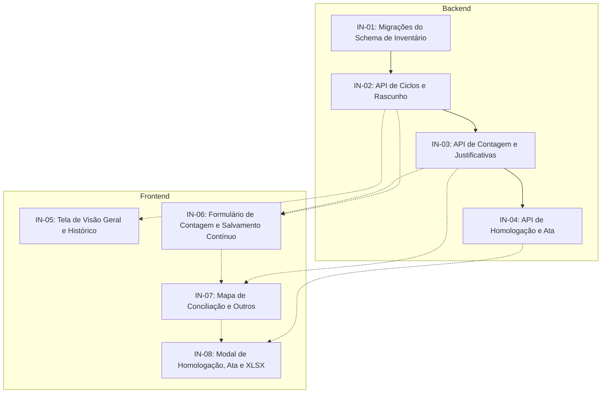

# Inventário Mensal (RF009, RF011, RF013, RF014, RF021, RF028, NF001, NF002, NF003, NF005, NF007, NF008, NF009, NF015)

## Visão geral do épico e história de usuário

> **Como** farmacêutico responsável da farmácia da UBS,  
> **quero** realizar ciclos periódicos de inventário físico com conferência guiada dos medicamentos e lotes, registro de contagens em rascunho persistente, cálculo automático de divergências (sobras e faltas), justificativa sanitária obrigatória com suporte à categoria Outros e campo descritivo livre, homologação atômica de acerto de saldos e emissão da Ata Oficial de Inventário com exportação em planilha (.xlsx),  
> **para que** eu possa conciliar o estoque teórico do sistema com o estoque físico real nas prateleiras da farmácia, eliminar distorções contábeis e prestar contas mensalmente à Secretaria Municipal de Saúde e à CAF (RF013, RF014, RF021, RF028).

---

## Contexto operacional

Nas farmácias das UBS de Parnaíba-PI, o inventário mensal é uma rotina obrigatória para apurar perdas e conciliar os saldos físicos. Muitas vezes esse trabalho é feito em folhas impressas ou planilhas separadas, o que leva dias de digitação manual, gera erros de cálculo e atrasa o envio do fechamento mensal para a coordenação e a CAF.

Na reunião de 29/09/2026, a equipe definiu quatro pontos para o módulo de inventário:
1. Contagem guiada com salvamento contínuo em rascunho: o inventário pode durar vários plantões, então cada contagem lançada é salva imediatamente para evitar perda de dados por queda de conexão;
2. Cálculo de divergências em tempo real: o sistema compara o estoque teórico congelado no início do ciclo com a contagem física informada, apontando sobras, faltas ou itens regulares;
3. Justificativa obrigatória com opção Outros: qualquer divergência exige um motivo regulamentar. Para cobrir imprevistos da rotina da UBS (como entregas da CAF deixadas na farmácia antes da conferência), a opção Outros foi mantida e exige texto explicativo com no mínimo 15 caracteres;
4. Homologação atômica e Ata Oficial: a conclusão do ciclo acerta os saldos no banco de dados, registra as movimentações de auditoria e emite a Ata Oficial de Inventário com folha de estilo para impressão e exportação em planilha (.xlsx).

---

## Escopo do épico

### Requisitos funcionais cobertos

Requisitos canônicos descritos em [farmaubs-requisitos.md](../../documento-requisitos/farmaubs-requisitos.md):

| RF | Descrição canônica | Histórias associadas |
| --- | --- | --- |
| RF013 | Realizar Inventário Mensal: exibição dos medicamentos cadastrados para contagem física, cálculo de sobras e faltas e acerto de estoque após homologação. | IN-01, IN-02, IN-03, IN-04, IN-06, IN-07, IN-08 |
| RF014 | Consultar Histórico de Inventários: listagem dos ciclos de inventário com estoque teórico, contagem física, responsável técnico e resumo de divergências. | IN-02, IN-04, IN-05 |
| RF021 | Gerar Relatório de Inventário Mensal: emissão do relatório oficial com saldo anterior, entradas, saídas, saldo atual e validades, disponível em .xlsx e impressão. | IN-04, IN-08 |
| RF009 | Registrar Ajuste de Estoque (Entrada): acréscimos gerados pela homologação de sobras apuradas no inventário, com log de auditoria. | IN-04 |
| RF011 | Registrar Ajuste de Estoque (Saída): reduções geradas pela homologação de faltas apuradas no inventário, com motivo e justificativa. | IN-04 |
| RF028 | Consultar Log de Auditoria: registro das movimentações geradas na homologação com identificação do farmacêutico, horário e ata vinculada. | IN-01, IN-03, IN-04, IN-08 |

### Requisitos não funcionais cobertos

| NF | Descrição canônica | Histórias associadas |
| --- | --- | --- |
| NF001 | Interface Intuitiva e Adaptada ao Contexto: fluxo de conferência claro, mapa de divergências com filtros de status e uso de cores para regular, sobra e falta. | IN-05, IN-06, IN-07, IN-08 |
| NF002 | Design Responsivo: interface adaptada para computadores de mesa e tablets. | IN-05, IN-06, IN-07, IN-08 |
| NF003 | Suporte ao Idioma Português (Brasil): datas em DD/MM/AAAA, números no formato nacional e terminologia oficial do SUS. | Todas |
| NF005 | Persistência de Dados em Caso de Falha: salvamento contínuo das contagens a cada 30 segundos, sem perda de dados em caso de queda de rede. | IN-02, IN-03, IN-06 |
| NF007 | Tempo de Resposta da Interface: cálculo de divergências na tela e consultas em até 2 segundos. | IN-02, IN-03, IN-07 |
| NF008 | Geração de Relatórios: emissão da Ata Oficial e exportação da planilha em até 30 segundos. | IN-04, IN-08 |
| NF009 | Controle de Acesso Baseado em Perfil (RBAC): abertura, contagem e homologação restritas a Farmacêutico Responsável/Residente; Gerente e Administrador possuem perfil de consulta. | Todas |
| NF015 | Isolamento de Dados por UBS (Multi-tenancy): isolamento estrito dos ciclos e dos saldos de cada unidade via RLS no PostgreSQL. | IN-01, IN-02, IN-03, IN-04 |

### Registros de arquitetura aplicados (ADRs)

| ADR | Tema | Histórias associadas |
| --- | --- | --- |
| ADR-002 / ADR-016 | Isolamento multi-tenant por UBS via RLS no PostgreSQL | IN-01, IN-02, IN-03, IN-04 |
| ADR-003 | Arquitetura Hexagonal no Backend | IN-01, IN-02, IN-03, IN-04 |
| ADR-006 | Controle de acesso RBAC por perfil | Todas |
| ADR-007 | Rotas REST `/api/v1/*`, DTOs e Swagger | IN-02, IN-03, IN-04 |
| ADR-008 / ADR-015 | Consistência transacional com lock pessimista na homologação | IN-04 |
| ADR-011 | Frontend React 19, Vite e Tailwind CSS | IN-05, IN-06, IN-07, IN-08 |
| ADR-013 | Gerenciamento de estado com Context API e TanStack Query | IN-05, IN-06, IN-07, IN-08 |
| ADR-022 | Contratos e DTOs compartilhados em `@farmaubs/shared` | Todas |
| ADR-030 | Pirâmide de testes BDD (Camadas A, B, C e D) | Todas |
| ADR-032 | Acessibilidade digital WCAG 2.1 AA | IN-05, IN-06, IN-07, IN-08 |

---

## Diretrizes de negócio e decisões operacionais

1. Abertura do ciclo e congelamento do saldo teórico:
   - Ao abrir um inventário, o sistema define o status como `EM_ANDAMENTO` e congela uma foto dos saldos de todos os lotes ativos na unidade. Não é permitido abrir dois ciclos ao mesmo tempo na mesma UBS.

2. Contagem física com salvamento contínuo:
   - O farmacêutico lança a quantidade contada por medicamento e lote. Cada alteração é salva no rascunho do ciclo. A tela calcula a diferença imediatamente:
     $$\text{divergencia} = \text{quantidadeFisica} - \text{estoqueTeorico}$$

3. Justificativa obrigatória e suporte ao motivo Outros:
   - Se houver divergência, o preenchimento de justificativa é obrigatório. O ciclo não pode ser homologado se restar qualquer diferença sem justificativa.
   - Motivos de sobra: erro na conferência de entrada, dispensa não efetivada ou outros.
   - Motivos de falta: validade vencida, avaria física, extravio, erro de digitação, entrega da CAF sem conferência ou outros.
   - Ao escolher Outros, é obrigatório digitar um texto descritivo com pelo menos 15 caracteres.

4. Homologação atômica dos saldos:
   - A confirmação da homologação executa uma transação atômica no banco: muda o status do ciclo para `HOMOLOGADO`, ajusta os saldos dos lotes, registra os eventos de auditoria e emite a Ata Oficial com o identificador do farmacêutico responsável.

5. Ata Oficial e relatório formal:
   - A Ata Oficial conta com visualização própria para impressão no navegador (`@media print`), trazendo os dados da UBS, a tabela de divergências com as justificativas e o espaço para assinatura do responsável e da gerência. A tela também oferece botão para baixar a planilha em formato Excel (.xlsx).

---

## Backlog do épico

### Backend e fundação

| ID | Título | Testes | Depende de | Status |
| --- | --- | --- | --- | --- |
| [IN-01](./in-01-backend-migrations-schema-inventario.md) | Migrações do schema de inventário (`ciclos_inventario`, `inventario_itens`, `atas_inventario` e movimentações) | B | RE-01 | ✅ Redigida |
| [IN-02](./in-02-backend-api-ciclos-iniciar-snapshot-status.md) | API de Ciclos: início de ciclo, congelamento de saldo teórico, rascunho persistente e status | A, C | IN-01 | ✅ Redigida |
| [IN-03](./in-03-backend-api-contagem-divergencias-justificativas-outros.md) | API de Contagem: lançamento físico por lote, cálculo de diferenças e validação da justificativa Outros | A, C | IN-02 | ✅ Redigida |
| [IN-04](./in-04-backend-api-homologacao-ajuste-saldos-ata-relatorio-xlsx.md) | API de Homologação: fechamento transacional, acerto de saldos, Ata Oficial e exportação em XLSX | A, B, C | IN-03 | ✅ Redigida |

### Frontend

| ID | Título | Testes | Depende de | Status |
| --- | --- | --- | --- | --- |
| [IN-05](./in-05-frontend-tela-visao-geral-historico-ciclos.md) | Tela de visão geral: histórico de inventários realizados, indicador de ciclo ativo e início de ciclo | D | IN-02 | ✅ Redigida |
| [IN-06](./in-06-frontend-formulario-contagem-fisica-busca-autosave.md) | Formulário de contagem física: digitação por lote com busca textual e salvamento contínuo | D | IN-02, IN-03 | ✅ Redigida |
| [IN-07](./in-07-frontend-mapa-conciliacao-divergencias-seletor-outros.md) | Mapa de conciliação: comparação em tempo real, seleção de motivos e justificativa para Outros | D | IN-03, IN-06 | ✅ Redigida |
| [IN-08](./in-08-frontend-modal-homologacao-ata-impressao-exportacao-xlsx.md) | Modal de homologação: resumo das diferenças, impressão da Ata Oficial e exportação em XLSX | D | IN-04, IN-07 | ✅ Redigida |

---

## Sequenciamento recomendado

---

## Critérios de conclusão do épico (DoD)

- [x] 8 histórias de usuário redigidas com critérios de aceite em Gherkin em português e contratos TypeScript.
- [ ] Schema de banco com migrações, chaves estrangeiras, índices e políticas de RLS ativas por UBS.
- [ ] Congelamento de saldo teórico no início do ciclo e persistência contínua de contagens em rascunho a cada 30 segundos.
- [ ] Bloqueio da homologação para ciclos com divergências sem justificativa cadastrada.
- [ ] Justificativa para a categoria Outros com descrição livre de no mínimo 15 caracteres.
- [ ] Atualização atômica de saldos no fechamento do inventário com registros de auditoria.
- [ ] Ata Oficial de Inventário com folha de estilo para impressão direta (`@media print`) e exportação em planilha Excel (.xlsx).
- [ ] Testes automatizados cobrindo as camadas A, B, C e D.
