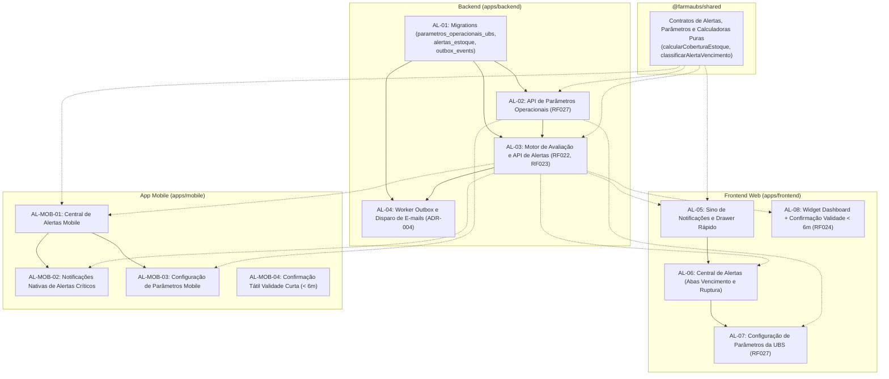

# Alertas, Notificações e Parâmetros Operacionais (RF022, RF023, RF024, RF026, RF027, RF028, NF001, NF002, NF003, NF007, NF009, NF015, NF018)

## Visão geral do épico e história de usuário

> **Como** farmacêutico responsável, farmacêutico residente, gerente ou administrador da UBS,  
> **quero** um módulo ativo de monitoramento e alertas que identifique automaticamente lotes próximos ao vencimento e medicamentos em risco de ruptura de estoque com base nos parâmetros operacionais configuráveis da minha unidade (limiar de validade, estoque de segurança e *lead time* de entrega da CAF), exibindo notificações visuais no painel web e no aplicativo móvel, exigindo confirmação expressa no recebimento de lotes com validade curta (< 6 meses) e disparando avisos assíncronos por e-mail via *Transactional Outbox*,  
> **para que** a farmácia deixe de operar de forma meramente reativa, prevenindo perdas de medicamentos por expiração nas prateleiras e antecipando pedidos ou remanejamentos antes que ocorra falta de medicamentos de uso contínuo para a população atendida pelo SUS (RF022, RF023, RF024, RF027, RF028).

---

## Contexto operacional e decisão de priorização (Novo Incremento 2)

Nas farmácias das Unidades Básicas de Saúde de Parnaíba-PI, dois problemas críticos coexistem diariamente: o vencimento silencioso de lotes estocados com menor giro e a ruptura abrupta de medicamentos essenciais de uso contínuo (como anti-hipertensivos e antidiabéticos) devido à falta de visibilidade antecipada sobre a cobertura em dias frente ao prazo de entrega da Central de Abastecimento Farmacêutico (CAF).

Na concepção original do projeto, o módulo de alertas estava alocado no Incremento 3, após a camada de inteligência gerencial avançada (Curva ABC e relatórios analíticos complexos). Contudo, a análise de dependências arquiteturais demonstrou que:
1. **Inexistência de bloqueio cronológico**: O motor de alertas depende apenas dos saldos de lotes (`lotes`), do histórico básico de saídas (`dispensacoes` / `movimentacoes_estoque`) e dos parâmetros da UBS (`unidades_saude`), todos já entregues no Incremento 1;
2. **Menor complexidade e entrega rápida de valor**: Enquanto relatórios gerenciais multi-período e Curva ABC exigem agregações pesadas, gráficos analíticos complexos e motores de exportação PDF/XLSX, o módulo de alertas apoia-se em regras determinísticas diretas e no padrão *Transactional Outbox* já previsto no **ADR-004**;
3. **Impacto sanitário imediato**: Antecipar o Épico 6 como **Incremento 2** transforma o FarmaUBS imediatamente de um sistema de registro passivo em um guardião ativo do estoque da UBS.

---

## Escopo do épico

### Requisitos funcionais cobertos

Requisitos canônicos descritos em [farmaubs-requisitos.md](../../documento-requisitos/farmaubs-requisitos.md):

| RF | Descrição canônica | Histórias associadas |
| --- | --- | --- |
| RF022 | Alertar Medicamentos Próximos ao Vencimento: alertas visuais (no dashboard/central e mobile) e por e-mail para lotes com validade igual ou inferior ao limiar configurado (padrão: 90 dias), destacando lote, quantidade e data de vencimento. | AL-01, AL-03, AL-04, AL-05, AL-06, AL-08, AL-MOB-01, AL-MOB-02 |
| RF023 | Alertar Risco de Ruptura de Estoque: identificação e alerta de medicamentos cuja cobertura em dias (com base no consumo médio diário) seja inferior ao tempo médio de entrega da CAF somado à margem de estoque de segurança configurável. | AL-01, AL-03, AL-04, AL-05, AL-06, AL-08, AL-MOB-01, AL-MOB-02 |
| RF024 | Alertar Recebimento de Medicamentos com Validade Curta: aviso bloqueante de confirmação explícita ao registrar entrada de lote com validade inferior a 6 meses (180 dias). | AL-08, AL-MOB-04 |
| RF026 | Gerenciar UBSs: manutenção do tempo médio de entrega da CAF (`caf_lead_time_days`) e dados operacionais da unidade. | AL-01, AL-02, AL-07, AL-MOB-03 |
| RF027 | Configurar Parâmetros do Sistema: configuração por UBS do limiar de alerta de vencimento (em dias), estoque de segurança (em dias de cobertura), tempo médio de entrega da CAF e preferências de notificação, com recálculo imediato dos alertas. | AL-01, AL-02, AL-07, AL-MOB-03 |
| RF028 | Consultar Log de Auditoria: registro imutável de alterações nos parâmetros operacionais da UBS e das confirmações de recebimento de lotes com validade curta. | AL-01, AL-02, AL-08, AL-MOB-03, AL-MOB-04 |

### Requisitos não funcionais cobertos

| NF | Descrição canônica | Histórias associadas |
| --- | --- | --- |
| NF001 | Interface Intuitiva e Adaptada ao Contexto: sino de notificações no topo, central dividida em duas abas claras (Vencimento e Ruptura) e semáforo visual de severidade (amarelo/laranja para atenção, vermelho para crítico). | AL-05, AL-06, AL-07, AL-08, AL-MOB-01 a 04 |
| NF002 | Design Responsivo e Ergonomia Mobile: central de alertas e configurações adaptadas para desktop, tablets e smartphones. | AL-05 a AL-08, AL-MOB-01 a 04 |
| NF003 | Suporte ao Idioma Português (Brasil): datas em DD/MM/AAAA, contagens em dias inteiros e vocabulário farmacêutico do SUS. | Todas |
| NF007 | Tempo de Resposta da Interface: consulta do resumo de alertas ativos e listagem filtrada em menos de 1 segundo. | AL-03, AL-05, AL-06, AL-MOB-01 |
| NF009 | Controle de Acesso Baseado em Perfil (RBAC): visualização de alertas para todos os perfis da UBS; alteração de parâmetros operacionais (`RF027`) restrita a `ADMINISTRADOR` e `FARMACEUTICO_RESPONSAVEL`. | AL-02, AL-07, AL-MOB-03 |
| NF015 | Isolamento de Dados por UBS (Multi-tenancy): alertas e parâmetros estritamente isolados por município e unidade via Row-Level Security (RLS) no PostgreSQL. | AL-01, AL-02, AL-03, AL-04 |
| NF018 | Auditabilidade e Rastreabilidade: toda mudança de parâmetro operacional ou aceite de validade curta gera registro de auditoria com estado anterior, estado posterior, usuário e *timestamp*. | AL-01, AL-02, AL-08, AL-MOB-04 |

### Registros de arquitetura aplicados (ADRs)

| ADR | Tema | Histórias associadas |
| --- | --- | --- |
| ADR-001 / ADR-004 | Comunicação entre módulos via portas e eventos assíncronos via *Transactional Outbox* no PostgreSQL | AL-01, AL-03, AL-04 |
| ADR-002 / ADR-016 | Isolamento multi-tenant por município e UBS via RLS no PostgreSQL | AL-01, AL-02, AL-03, AL-04 |
| ADR-003 / ADR-033 | Clean Architecture pura no Backend (Use Cases desacoplados de ORM/Framework) | AL-01, AL-02, AL-03, AL-04 |
| ADR-006 | Autenticação server-side e autorização RBAC por perfil | Todas |
| ADR-007 | Estratégia de API REST `/api/v1/*`, DTOs validados e documentação Swagger | AL-02, AL-03 |
| ADR-010 | Fórmula determinística e auditável de consumo médio, cobertura e ponto de pedido | AL-03 |
| ADR-011 / ADR-013 | Frontend React 19, Vite, Tailwind CSS v4 e TanStack Query | AL-05, AL-06, AL-07, AL-08 |
| ADR-022 / ADR-035 | Contratos e calculadoras puras compartilhadas em `@farmaubs/shared` | Todas |
| ADR-030 | Pirâmide de testes automatizados em BDD (Camadas A, B, C e D) | Todas |
| ADR-032 | Acessibilidade digital WCAG 2.1 AA (`aria-live`, contraste, navegação por teclado) | AL-05, AL-06, AL-07, AL-08 |
| ADR-034 | Workspace Mobile React Native + Expo (`expo-notifications`, Keystore) | AL-MOB-01, AL-MOB-02, AL-MOB-03, AL-MOB-04 |

---

## Diretrizes de negócio e fórmulas matemáticas

1. **Parâmetros Operacionais Configuráveis por UBS (RF027)**:
   - Cada UBS possui sua própria configuração operacional (com valores padrão iniciais na criação da unidade):
     - `limiarVencimentoDias`: padrão **90 dias** (mínimo 15, máximo 365 dias);
     - `estoqueSegurancaDias`: padrão **7 dias** de cobertura adicional (mínimo 0, máximo 90 dias);
     - `cafLeadTimeDays`: padrão **15 dias** (tempo médio de entrega da CAF, mínimo 1, máximo 60 dias);
     - `janelaConsumoDias`: padrão **90 dias** (3 meses para apuração do Consumo Médio Diário — CMD);
     - `notificarEmailVencimento` e `notificarEmailRuptura`: flags booleanas (padrão `true`).

2. **Regra de Avaliação de Vencimento Próximo (RF022)**:
   - Avalia todos os lotes da UBS com `saldo_atual > 0`:
     $$\text{diasParaVencer} = \lfloor \text{dataValidade} - \text{dataAtual} \rfloor$$
   - Classificação de severidade:
     - **VENCIDO (`CRITICO`)**: $\text{diasParaVencer} \le 0$;
     - **VENCIMENTO CRÍTICO (`CRITICO`)**: $0 < \text{diasParaVencer} \le 30$;
     - **VENCIMENTO EM ATENÇÃO (`ATENCAO`)**: $30 < \text{diasParaVencer} \le \text{limiarVencimentoDias}$.

3. **Regra de Avaliação de Risco de Ruptura de Estoque (RF023, ADR-010)**:
   - Como um medicamento pode possuir múltiplos lotes ativos na UBS, o cálculo de ruptura é feito sobre a **soma consolidada dos saldos de lotes válidos** (não vencidos) daquele produto na unidade:
     $$\text{SaldoConsolidado} = \sum_{\text{lotes válidos}} \text{saldo\_atual}$$
     $$\text{CMD} = \frac{\text{Total de Unidades Dispensadas nos últimos } \text{janelaConsumoDias}}{\text{janelaConsumoDias}}$$
     $$\text{CoberturaDias} = \begin{cases} \lfloor \frac{\text{SaldoConsolidado}}{\text{CMD}} \rfloor, & \text{se } \text{CMD} > 0 \\ \infty, & \text{se } \text{CMD} = 0 \text{ e } \text{SaldoConsolidado} > 0 \\ 0, & \text{se } \text{SaldoConsolidado} = 0 \end{cases}$$
     $$\text{PontoCriticoDias} = \text{cafLeadTimeDays} + \text{estoqueSegurancaDias}$$
   - Classificação de severidade:
     - **ESTOQUE ZERADO (`CRITICO`)**: $\text{SaldoConsolidado} = 0$ (para medicamento com histórico de dispensação ou ativo na relação da UBS);
     - **RUPTURA IMINENTE (`CRITICO`)**: $0 < \text{CoberturaDias} \le \text{cafLeadTimeDays}$;
     - **RISCO DE RUPTURA (`ATENCAO`)**: $\text{cafLeadTimeDays} < \text{CoberturaDias} \le \text{PontoCriticoDias}$.

4. **Ciclo de Vida e Auto-Resolução de Alertas**:
   - Alertas possuem status `ATIVO`, `LIDO` (confirmado visualmente pelo profissional, mas condição ainda presente) ou `RESOLVIDO` (encerrado automaticamente quando o saldo é recomposto por uma entrada da CAF ou quando o lote vencido/curto é totalmente dispensado ou baixado por descarte).
   - A alteração de parâmetros em `RF027` recalcula imediatamente todos os alertas da UBS na mesma transação.

5. **Outbox Transacional e Envio de E-mail sem Spam (ADR-004)**:
   - Quando um alerta inédito de nível `CRITICO` ou `ATENCAO` é aberto, um evento `ALERTA_ESTOQUE_CRIADO` é gravado na tabela `outbox_events` na mesma transação.
   - O worker interno processa a fila assincronamente e envia o e-mail institucional para o `FARMACEUTICO_RESPONSAVEL` vinculado à UBS, garantindo deduplicação por chave `(ubs_id, tipo_alerta, referencia_id, data_referencia)` para nunca enviar e-mails repetidos sobre o mesmo lote/produto no mesmo dia.

---

## Backlog do épico

### Backend e fundação

| ID | Título | Testes | Depende de | Status |
| --- | --- | --- | --- | --- |
| [AL-01](./al-01-backend-migrations-schema-alertas-parametros-outbox.md) | Migrações do schema de alertas, parâmetros operacionais por UBS e tabela `outbox_events` | B | RE-01, DI-01 | ✅ Redigida |
| [AL-02](./al-02-backend-api-parametros-operacionais-ubs.md) | API de Parâmetros Operacionais da UBS: consulta, edição validada, auditoria e gatilho de recálculo | A, C | AL-01 | ✅ Redigida |
| [AL-03](./al-03-backend-motor-avaliacao-alertas-vencimento-ruptura-api.md) | Motor de Avaliação e API de Alertas: cálculo de vencimento e cobertura em dias, listagem por abas e leitura | A, B, C | AL-01, AL-02 | ✅ Redigida |
| [AL-04](./al-04-backend-worker-outbox-notificacoes-email.md) | Worker Outbox e Notificações por E-mail: processamento assíncrono idempotente de alertas para o responsável | A, B | AL-01, AL-03 | ✅ Redigida |

### Frontend Web (`apps/frontend`)

| ID | Título | Testes | Depende de | Status |
| --- | --- | --- | --- | --- |
| [AL-05](./al-05-frontend-sino-notificacoes-header-drawer-resumo.md) | Sino de Notificações no Cabeçalho e Drawer Rápido: badge de não lidos, pré-visualização e confirmação de leitura | D | AL-03 | ✅ Redigida |
| [AL-06](./al-06-frontend-central-alertas-abas-vencimento-ruptura.md) | Tela Central de Alertas: abas de Vencimento Próximo e Risco de Ruptura, filtros de severidade e ações rápidas | D | AL-03, AL-05 | ✅ Redigida |
| [AL-07](./al-07-frontend-modal-pagina-configuracao-parametros-ubs.md) | Tela/Modal de Parâmetros Operacionais da UBS: configuração de limiares, *lead time* CAF e estoque de segurança | D | AL-02, AL-06 | ✅ Redigida |
| [AL-08](./al-08-frontend-widget-alertas-ativos-dashboard-confirmacao-validade-curta.md) | Widget de Alertas Críticos no Dashboard e Modal de Confirmação de Validade Curta (< 6 meses) no Recebimento | D | AL-03, RE-06 | ✅ Redigida |

### Mobile (`apps/mobile`)

| ID | Título | Testes | Depende de | Status |
| --- | --- | --- | --- | --- |
| [AL-MOB-01](./al-mob-01-central-alertas-vencimento-ruptura-mobile.md) | Central de Alertas no Celular: abas de vencimento próximo e risco de ruptura com marcação de leitura por toque | Mobile | AL-03 | ✅ Redigida |
| [AL-MOB-02](./al-mob-02-notificacoes-push-locais-alertas-criticos-mobile.md) | Notificações Nativas no Dispositivo Móvel para Novos Alertas Críticos de Ruptura e Vencimento na UBS Ativa | Mobile | AL-03, AL-MOB-01 | ✅ Redigida |
| [AL-MOB-03](./al-mob-03-configuracao-parametros-operacionais-ubs-mobile.md) | Configuração Rápida de Parâmetros Operacionais da UBS no Celular (Limiar de Validade, Segurança e CAF) | Mobile | AL-02, AL-MOB-01 | ✅ Redigida |
| [AL-MOB-04](./al-mob-04-alerta-bloqueante-recebimento-validade-curta-mobile.md) | Alerta Tátil Bloqueante de Confirmação no Recebimento de Lotes com Validade Curta (< 6 meses) no Celular | Mobile | RE-MOB-02 | ✅ Redigida |

---

## Sequenciamento recomendado

---

## Critérios de conclusão do épico (DoD)

- [x] 12 histórias de usuário redigidas (4 Backend, 4 Frontend Web e 4 Mobile) com critérios de aceite em Gherkin (pt-BR) e contratos TypeScript em `@farmaubs/shared`.
- [ ] Tabelas `parametros_operacionais_ubs`, `alertas_estoque` e `outbox_events` criadas via migrations com políticas RLS multi-tenant ativas.
- [ ] Configuração de parâmetros por UBS (`RF027`) restrita a Administrador e Farmacêutico Responsável, recalculando os alertas imediatamente e gravando log de auditoria (`RF028`).
- [ ] Motor determinístico de alertas avaliando vencimento próximo (`RF022`) e cobertura de estoque em dias frente ao *lead time* da CAF + margem de segurança (`RF023`).
- [ ] Worker de *Transactional Outbox* (`ADR-004`) enviando notificações por e-mail de forma idempotente e sem duplicidade diária.
- [ ] Sino de notificações, Central de Alertas em duas abas e diálogo bloqueante para recebimento de lotes com validade inferior a 6 meses (`RF024`) operantes no Web e no Mobile.
- [ ] Testes automatizados cobrindo as camadas A (Domínio puro), B (Banco e RLS), C (Contrato HTTP/E2E), D (Componentes Web) e Mobile.
